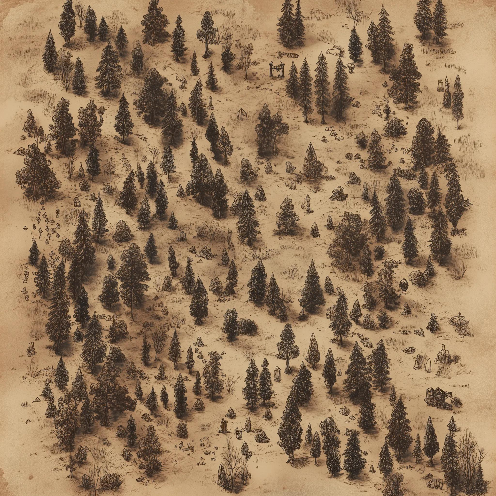
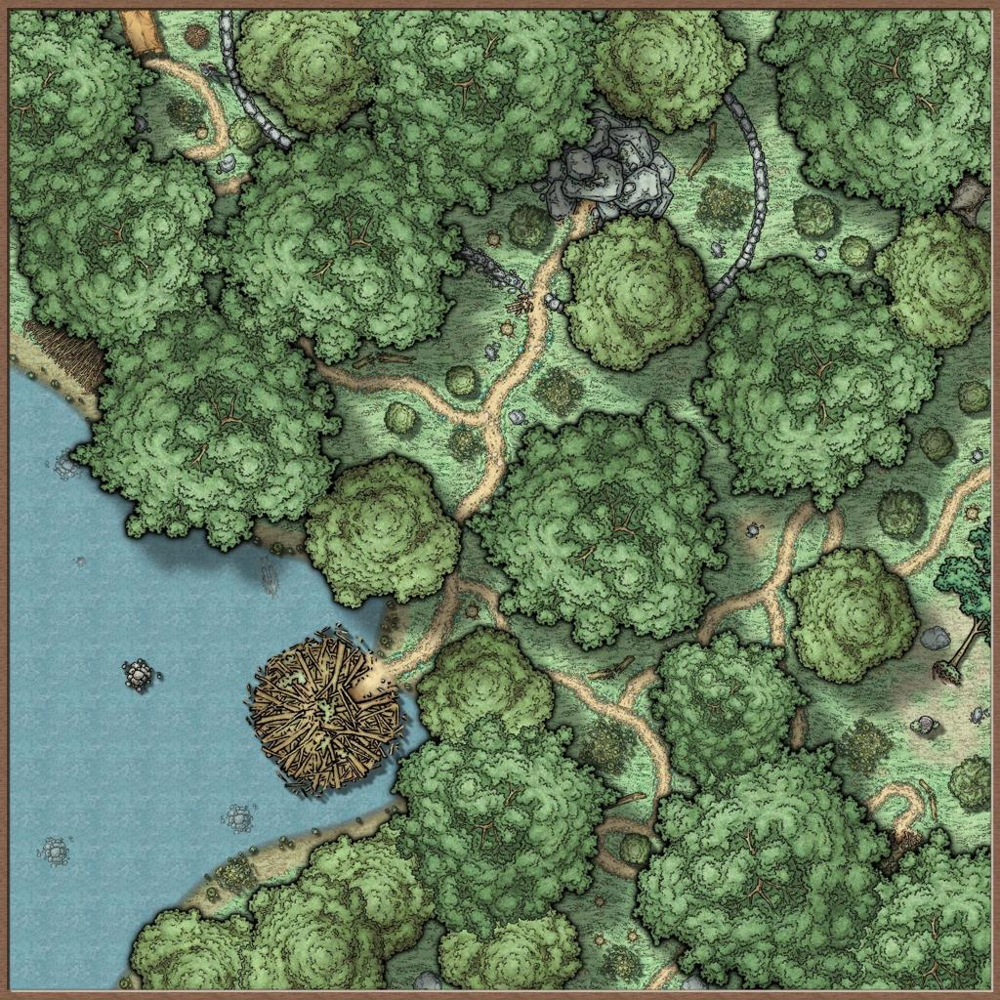
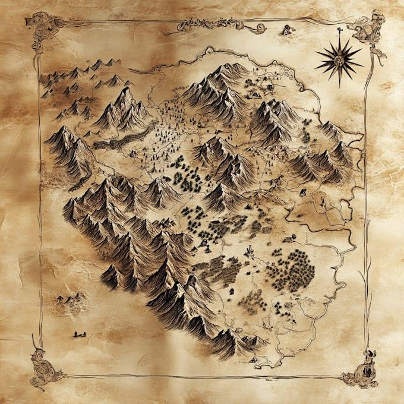
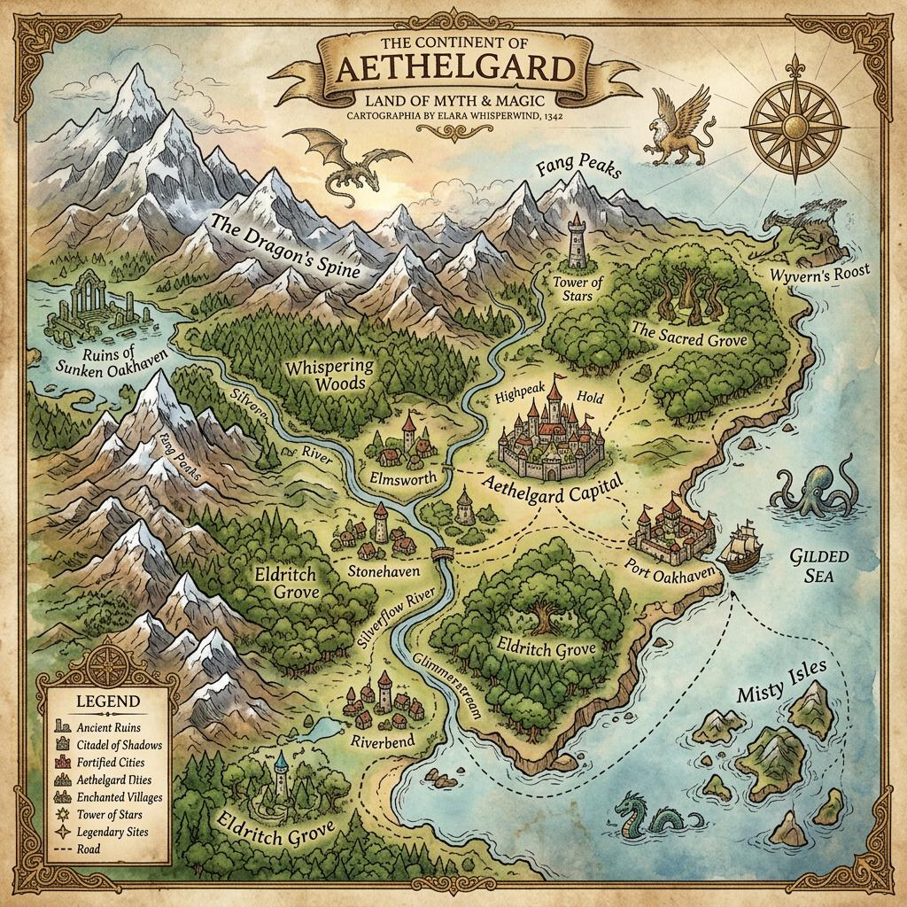
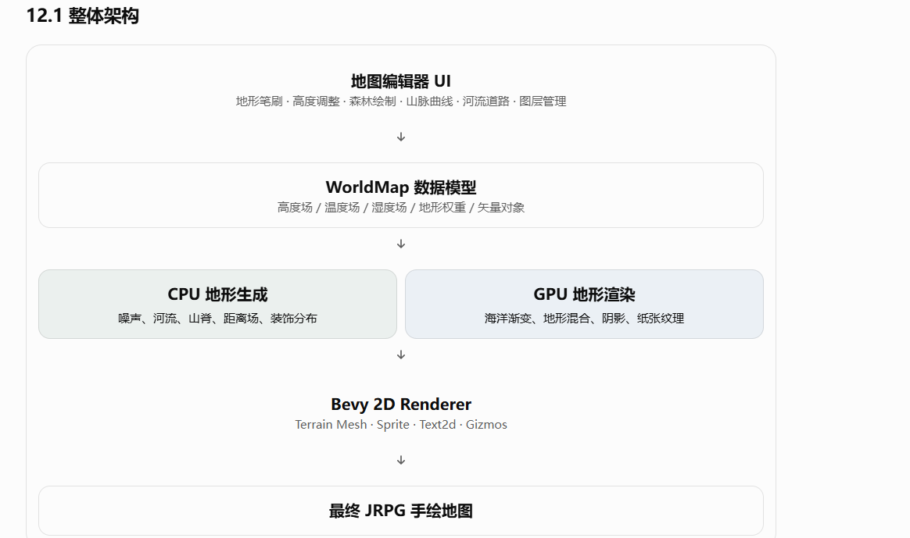

# Codex 外部输入记录（原始）

> **状态：原始记录，未分析、未采纳。**
> 本文件只做逐字留痕，**不是**设计结论、**不是** ADR、**不是**基线。
> 评审结果见 [`CODEX_REVIEW.md`](CODEX_REVIEW.md)；在评审获裁前，不得引用本文件作为决策依据。

- 记录开始：2026-10-21
- 来源：Codex（外部模型），用户逐条粘贴
- 记录规则：
  1. 原文照录，不改写、不删减、不修错别字；
  2. 只加条目标题、来源与分隔线；
  3. **未收到「开始分析」指令前，不解读、不评价、不落地**。

---

## 条目 1

> 附：图 1.jpg（680×680，手绘等距世界地图）——本条回复所针对的参考图。
> 以下为**第 1 次粘贴**，原文在「一、先拆解你的参考图片」处截断，后续续接。
> 记录者注：粘贴文本开头有一段重复（标题至「一、先拆解你的参考图片」出现两遍），照录未删。

### 粘贴 1

使用 Rust + Bevy 实现日系 JRPG 2D 世界地图编辑器：完整技术方案
你提供的图片是一张典型的 日系 JRPG 手绘风格世界地图，融合了地形生成、自然地貌、手绘纹理、地形装饰、道路、城市和文字标注。

如果你想使用 Rust + Bevy 开发一个能够生成、绘制和编辑这种地图的编辑器，我建议采用：

程序化地形生成 + 多层地形数据 + 2D Mesh 渲染 + Shader 材质混合 + 手绘素材实例化 + 可编辑图层。

这比单纯使用 TileMap（瓦片地图）更适合你的目标。

原因是，你提供的地图具有以下特征：
- 海岸线是不规则曲线，而不是方形格子。
- 草原、沙漠、雪原、森林之间存在自然过渡。
- 山脉具有明确的走向、阴影和手绘轮廓。
- 近海与深海有不同颜色，海岸还有浅色描边。
- 森林由许多大小、方向、密度不同的树木符号组成。
- 地形本身是平面的，但通过阴影、纹理和高度信息营造了立体感。
- 城市、道路、河流、地名和装饰是独立的可编辑对象。
因此，这不是简单地生成一张噪声贴图，而是构建一套 2.5D 地形生成与地图绘制系统。

一、先拆解你的参考图片 使用 Rust + Bevy 实现日系 JRPG 2D 世界地图编辑器：完整技术方案
你提供的图片是一张典型的 日系 JRPG 手绘风格世界地图，融合了地形生成、自然地貌、手绘纹理、地形装饰、道路、城市和文字标注。

如果你想使用 Rust + Bevy 开发一个能够生成、绘制和编辑这种地图的编辑器，我建议采用：

程序化地形生成 + 多层地形数据 + 2D Mesh 渲染 + Shader 材质混合 + 手绘素材实例化 + 可编辑图层。

这比单纯使用 TileMap（瓦片地图）更适合你的目标。

原因是，你提供的地图具有以下特征：
- 海岸线是不规则曲线，而不是方形格子。
- 草原、沙漠、雪原、森林之间存在自然过渡。
- 山脉具有明确的走向、阴影和手绘轮廓。
- 近海与深海有不同颜色，海岸还有浅色描边。
- 森林由许多大小、方向、密度不同的树木符号组成。
- 地形本身是平面的，但通过阴影、纹理和高度信息营造了立体感。
- 城市、道路、河流、地名和装饰是独立的可编辑对象。
因此，这不是简单地生成一张噪声贴图，而是构建一套 2.5D 地形生成与地图绘制系统。

一、先拆解你的参考图片

### 粘贴 2

> 记录者注：本条含制表符表格，已转 Markdown 表；`···` 代码围栏已补成 ```；文字与重复段未改。
> 粘贴在「3.1 使用多尺度噪声生成大陆」处截断，末行 `···` 是**未闭合**的代码围栏，原样保留。

同类型的手绘奇幻地图风格：地貌以二维图形呈现，通过纹理、图案和阴影表现高度。

按照你提供的地图，我会将整个画面拆成以下图层。图层顺序很重要，因为它决定哪些元素覆盖哪些元素。

| 图层 | 内容 | 推荐技术 |
|---|---|---|
| 0 | 纸张底纹、噪声颗粒 | 全屏 Shader |
| 1 | 深海、远洋 | 2D Mesh + Shader |
| 2 | 浅海、海岸浅水 | 距离场 Shader |
| 3 | 陆地轮廓 | Marching Squares + Mesh |
| 4 | 平原、草地、沙漠、雪原 | Biome Shader |
| 5 | 丘陵、高原、悬崖 | 高度场 + 纹理 |
| 6 | 山峰、山脉 | 程序化分布 + 手绘 Sprite |
| 7 | 森林、草丛、岩石 | 程序化实例 |
| 8 | 湖泊、河流 | 曲线 Mesh |
| 9 | 道路、桥梁 | 曲线 Mesh |
| 10 | 城堡、城市、村庄 | Sprite / Atlas |
| 11 | 地名、区域名 | Text2d |
| 12 | 选区、笔刷、编辑器辅助线 | Bevy Gizmos / Mesh |

这里有一个核心原则：

地图数据的生成，与地图视觉的绘制必须分离。

例如，同一片山脉在数据层面是一个具有海拔、坡度、岩石类型和山脊方向的区域；在渲染层面，它可以显示为手绘山峰、写实地形阴影，或者简化的战略地图符号。

这使你的地图编辑器可以支持多种地图风格，而不用重新生成世界。

二、世界地形的数据结构设计

首先，我们需要定义一张地图到底包含什么。

我建议使用连续的二维栅格数据作为基础，而不是直接把地形保存为图片。

假设地图尺寸为 4096 × 4096：

每个采样点保存高度、温度、湿度、海洋距离、坡度、地形类型等数据。

2.1 地形基础数据

```rust
#[derive(Clone, Copy, Debug)]
pub enum Biome {
    DeepOcean,
    Ocean,
    ShallowOcean,
    Beach,

    Grassland,
    Plains,
    Forest,
    DenseForest,

    Desert,
    Savanna,
    Swamp,

    Hills,
    Mountain,
    SnowMountain,

    Tundra,
    Snowfield,
}

#[derive(Clone, Copy)]
pub struct TerrainCell {
    // 海拔高度
    pub height: f32,

    // 温度
    pub temperature: f32,

    // 湿度
    pub moisture: f32,

    // 坡度
    pub slope: f32,

    // 到海岸线的有符号距离
    pub coast_distance: f32,

    // 地形类型
    pub biome: Biome,
}
```

实际工程中，4096² 个格子约有 1677 万个采样点。如果所有属性都放在一个结构体里，内存开销会比较大。

更适合的做法是采用 SoA（Structure of Arrays）：

实际工程中，4096² 个格子约有 1677 万个采样点。如果所有属性都放在一个结构体里，内存开销会比较大。

更适合的做法是采用 SoA（Structure of Arrays）：

```rust
pub struct TerrainMap {
    pub width: usize,
    pub height: usize,

    pub elevation: Vec<f32>,
    pub temperature: Vec<f32>,
    pub moisture: Vec<f32>,
    pub slope: Vec<f32>,
    pub coast_distance: Vec<f32>,
    pub biome: Vec<u8>,
}

impl TerrainMap {
    pub fn index(&self, x: usize, y: usize) -> usize {
        y * self.width + x
    }
}
```

这样每种数据都可以独立更新，也方便上传 GPU。

为什么要保存连续高度？
因为你需要根据高度推导：
- 哪里是海洋，哪里是陆地。
- 哪里是高原、丘陵、山脉。
- 河流从哪里流向哪里。
- 哪里适合生成森林。
- 山峰朝哪个方向排列。
- 哪些地方需要生成积雪。
- 地形之间应该如何自然过渡。

高度数据是整个系统的基础。

但要注意：高度并不等于最终显示颜色。 沙漠、森林和草原主要由气候及地表覆盖决定，而不是单纯由海拔决定。

三、生成大陆、岛屿与海岸线

这是整个地图最重要的一步。

你的参考图左侧是一块形状复杂的大陆，右侧是另一块巨大的陆地，中间由海洋分隔。

这类地形不应该只依靠一次 Perlin Noise 生成。

推荐使用：

大陆形状场 + 分形噪声 + Domain Warping（坐标扭曲）+ 高度场组合。

3.1 使用多尺度噪声生成大陆

···

### 粘贴 3

> 附：6 个示意 SVG（用户随贴提供，位于 `C:\Users\leo\Downloads\`，**未纳入仓库**）：
> `海岸扭曲.svg`、`大陆大尺度.svg`、`大陆小尺度.svg`、`大陆基础图.svg`、
> `大陆小尺度 - 副本.svg`、`大陆基础图 - 副本.svg`。
> 经查，六个文件**内容完全相同**：均为 340×160 的四联示意图，四格依次标注
> 「基础形状 / 大尺度噪声 / 小尺度噪声 / 海岸扭曲」。
> 记录者注：本条接续「3.1」，`···` 之后的内容；公式为 LaTeX 原文，照录。

示意：从大陆主体到具有海湾、岬角和半岛的复杂轮廓。

数学上可以定义：

\[
H(x,y)=C(x,y)+aN_1(x,y)+bN_2(x,y)+cN_3(x,y)
\]

其中：
- \(C(x,y)\)：大陆主体形状。
- \(N_1\)：低频噪声，控制大陆大轮廓。
- \(N_2\)：中频噪声，控制海湾与半岛。
- \(N_3\)：高频噪声，控制小型海岸变化。
- \(a,b,c\)：不同尺度的权重。

推荐使用 noise crate 中的 OpenSimplex 或 Perlin 噪声。

### 粘贴 4

> 记录者注：首段为原文的 toml 代码围栏；rust 示例原文以 `···` 围栏，已补成 rust 围栏。文字未改。

```toml
[dependencies]
noise = "0.9"
rand = "0.9"
```

rust 示例

```rust
use noise::{NoiseFn, OpenSimplex};

pub fn fbm(
    noise: &OpenSimplex,
    x: f64,
    y: f64,
    octaves: usize,
) -> f64 {
    let mut value = 0.0;
    let mut amplitude = 1.0;
    let mut frequency = 1.0;
    let mut total = 0.0;

    for _ in 0..octaves {
        value += noise.get([
            x * frequency,
            y * frequency,
        ]) * amplitude;

        total += amplitude;
        amplitude *= 0.5;
        frequency *= 2.0;
    }

    value / total
}
```

---

## 条目 2：PDF 结构化转写（接 3.1 之后）

> 说明：以下按 PDF 截图整理，**不是逐字誊录**；保留全部标题、论点、数字、公式与表格。
> 代码块多数因 ChatGPT 代码框可滚动而只留占位；少数截图内可见的片段按可见内容重建并标注。
> 图片已按位置补入 `docs/codex-assets/`。PDF 共 4 页、5 张长截图（1920×52730），与条目 1 合起来覆盖一～十八节。
> 对话开头的用户提问（与本次会话首条相同）未重复录入。

### 图片清单

| # | 节 | 内容 | 状态 |
|---|---|---|---|
| 1 | 开头 | 参考图（等距手绘世界地图） | 已补 `codex-assets/ref-map.jpg` |
| 2 | 3.1 | 海岸四联：基础形状 / 大尺度 / 小尺度 / 海岸扭曲 | 已补 `codex-assets/coast-warp.svg` |
| 3 | 4.1 | 海洋分层剖面：陆地→浅滩→近海→深海 | 已补 `codex-assets/ocean-layers.svg` |
| 4 | 6 | 森林 vs 密林 两张对比 | 已补 `codex-assets/forest-sparse.jpg`、`forest-dense.jpg` |
| 5 | 7 | 山脉参考两张：棕色山脉 / 雪山 | 已补 `codex-assets/mountain-brown.jpg`、`mountain-snow.jpg` |
| 6 | 7.2 | 沿山脊曲线布置山峰示意 | 已补 `codex-assets/ridge-placement.svg` |
| 7 | 12.1 | Bevy 渲染架构图（页面内绘制） | 已补 `codex-assets/architecture.png` |
| 8 | 13 | Chunk 网格 + 笔刷只更新受影响块 | 已补 `codex-assets/chunk-grid.svg` |
| 9 | 14 | 六种地形笔刷的 UI 原型 | 已补 `codex-assets/brush-ui.png` |

> 补录说明（2026-10-21）：9 处图已全部纳入 `docs/codex-assets/`。
> 用户补的 `TerrainCell` 与 `fbm` 代码与条目 1 的粘贴 2/4 一致，未重复收录。

### 3.1 尾：大陆生成

> 代码块（Rust）：`generate_height` —— 截图截断，待补。
> 可见部分：`large = fbm(noise, x*0.002, y*0.002, 4)`、`medium = fbm(..., 0.008, ..., 4)`、`detail = fbm(..., 0.025, ..., 3)`；`height = large*0.65 + medium*0.25 + detail*0.10`。

这段代码只是噪声基础，还没有实现大陆形状约束；仅用它可能得到很多零散岛屿，而不是参考图中的两块主要大陆。

实际编辑器应该允许用户绘制大陆蒙版，或通过距离场生成大陆主体，再叠加噪声。

### 3.2 Domain Warping：让海岸线更加自然

普通噪声容易产生相似的圆润轮廓。Domain Warping 先扭曲采样坐标：

\[
x' = x + k N_a(x,y)
\]
\[
y' = y + k N_b(x,y)
\]

然后：

\[
H(x,y) = N(x', y')
\]

> 代码块（Rust）：`warped_noise` —— 截图截断，待补。
> 可见部分：`warp_x = noise.get([x*0.004, y*0.004])`、`warp_y = noise.get([x*0.004+137.0, y*0.004+271.0])`、`wx = x + warp_x*80.0`、`wy = y + warp_y*80.0`、`fbm(noise, wx*0.006, wy*0.006, 5)`。

这样可以生成更自然的：海湾、半岛、岬角、海峡、大型岛屿、破碎的海岸线。

对于 JRPG 地图，建议把 Domain Warping 强度暴露给编辑器，让用户直接拖动滑块。

### 3.3 根据海平面划分陆地与海洋

定义一个海平面阈值：

`const SEA_LEVEL: f32 = 0.45;`

如果高度数据统一在 0～1：

`pub fn is_land(height: f32) -> bool { height >= SEA_LEVEL }`

注意，海平面应该是一个可调整的全局参数。用户拖动海平面滑块时，岛屿面积、海岸线、近海范围都可以随之改变。

### 四、近海、浅海、深海、远洋如何生成

你的图片中，海洋并不是一种蓝色。至少可以分成四种视觉层次。

> 图：[海洋分层剖面](codex-assets/ocean-layers.svg)，从海岸向外依次过渡：陆地→浅滩→近海→深海。

#### 4.1 深海

深海是整张地图的背景色。参考图中的深海主要为低饱和蓝色，带有纸张颗粒与轻微的颜色变化。

可以定义：

`pub const DEEP_OCEAN: [f32; 3] = [0.10, 0.24, 0.39];`

Shader 中：

`let deep_ocean = vec3<f32>(0.10, 0.24, 0.39);`

不要直接使用纯色填充。可以叠加低频噪声：

`let variation = noise_value * 0.06;`
`let color = deep_ocean + vec3<f32>(variation);`

最终效果应该是颜色微妙变化，而不是像云朵一样出现大块明暗区域。

#### 4.2 近海

近海可以由海岸距离控制。首先计算每个海洋像素到最近陆地的距离：

\[
D(x,y) = \min_{p \in Coast} \|(x,y)-p\|
\]

建议使用 Signed Distance Field（SDF，有符号距离场）。约定：

- \(D < 0\)：陆地
- \(D = 0\)：海岸线
- \(D > 0\)：海洋

这样可以根据距离自动划分水域。

> 代码块（Rust）：`OceanZone` + `ocean_zone` —— 截图截断，待补。
> 可见部分：`< 8.0 => Shore`、`< 35.0 => Shallow`、`< 100.0 => Coastal`、`_ => Deep`。

这里的距离以地图采样格为单位，仅为示例。

#### 4.3 浅海

浅海通常为青蓝色、浅绿色。可以用 smoothstep 混合颜色：

> 代码块（WGSL）：`ocean_color` —— 截图截断，待补。
> 可见部分：`shore = vec3(0.64,0.76,0.70)`、`shallow = vec3(0.32,0.57,0.64)`、`deep = vec3(0.10,0.24,0.39)`；`t1 = smoothstep(0.0,40.0,d)`、`t2 = smoothstep(40.0,130.0,d)`。

这能让近海颜色自然向深海过渡。

#### 4.4 海岸线描边

参考图中的海岸线有浅色描边。这不是海洋颜色渐变，而是一条独立的海岸边界效果。可以利用距离场：

`let coastline = 1.0 - smoothstep(0.0, 2.5, abs(distance));`

然后叠加浅米色：

`let coast_color = vec3<f32>(0.89, 0.84, 0.68);`
`color = mix(color, coast_color, coastline * 0.8);`

可以再叠加噪声扰动描边宽度，模拟手绘墨线的不均匀感。

#### 4.5 海底深度

如果编辑器希望进一步支持海沟、大陆架、海底山脉，就不能只用岸距离来推导深海。应该增加独立的 bathymetry（海底深度）数据。

> 代码块（Rust）：`OceanData { depth: Vec<f32>, distance_to_coast: Vec<f32> }` —— 截图截断，待补。

深度可以由海岸距离、海底噪声和海沟曲线共同决定：

\[
B(x,y) = B_{shelf}(D) + N_{seafloor}(x,y) + B_{trench}(x,y)
\]

其中 \(B_{shelf}\) 控制大陆架，\(B_{trench}\) 控制海沟。这样才可以同时表现近岸深水和远海浅滩等特殊地形。

### 五、平原、草原、森林、沙漠和雪原

陆地不应该根据高度直接决定颜色。例如，同样海拔 300 米的地方，可以是森林、沙漠、草原或者沼泽。正确的方式是建立一个生物群系（Biome）系统。

#### 5.1 地形分类依据

建议至少考虑五个因素：1 高度 elevation；2 温度 temperature；3 湿度 moisture；4 坡度 slope；5 距海距离 coast_distance。此外还可以增加纬度、河流距离、盛行风和雨影效应。

下面是一组可供编辑器初期使用的经验分类规则。假设高度、温度和湿度都已归一化到 0～1，海平面为 0.45。

| 地形 | 高度条件 | 温度 | 湿度 | 视觉效果 |
|---|---|---|---|---|
| 沙滩 | 0.45~0.47 | 任意 | 任意 | 浅黄色 |
| 平原 | 0.47~0.65 | 0.3~0.8 | 0.3~0.7 | 黄绿色 |
| 草原 | 0.47~0.70 | 0.4~0.9 | 0.2~0.5 | 绿色、稀疏草丛 |
| 森林 | 0.47~0.75 | 0.3~0.8 | 0.55~0.85 | 中绿色、树木 |
| 密林 | 0.47~0.75 | 0.5~1.0 | 0.8~1.0 | 深绿色、密集树冠 |
| 沙漠 | 0.47~0.75 | 0.6~1.0 | 0~0.2 | 沙黄色、沙丘 |
| 沼泽 | 低洼地 | 0.4~0.9 | 0.8~1.0 | 暗绿、水塘 |
| 丘陵 | 0.65~0.80 | 任意 | 任意 | 土黄、坡面阴影 |
| 山地 | 0.80~0.92 | 任意 | 任意 | 棕灰色山峰 |
| 雪山 | 0.92~1.0 | 低温 | 任意 | 灰白色山峰 |
| 雪原 | 任意陆地 | 极低温 | 任意 | 白色、淡灰色 |

这些是初始规则，不是自然地理的固定标准。真正生成时，应允许山地和森林等属性叠加。例如：一个地方可以同时是高山地形、针叶林覆盖和积雪状态。

#### 5.2 温度场生成

温度主要受纬度和海拔影响。可以使用：

\[
T(x,y) = T_{latitude}(y) - k H(x,y) + N_T(x,y)
\]

> 代码块（Rust）：`generate_temperature` —— 截图截断，待补。
> 可见部分：`latitude = (y/map_height - 0.5).abs()*2.0`；`base = 1.0 - latitude*0.8`；`altitude_cooling = (elevation-0.45).max(0.0)*0.7`；`(base - altitude_cooling + noise*0.08).clamp(0.0,1.0)`。

这样地图的高纬度和高海拔地区会更寒冷。但你提供的图片属于幻想世界地图，雪原的位置未必严格符合现实气候。编辑器最好支持手动绘制温度蒙版，覆盖自动生成结果。

#### 5.3 湿度场生成

最简单的方法是使用独立噪声：

> 代码块（Rust）：`generate_moisture` —— 截图截断，待补。
> 可见部分：`fbm(noise, x*0.003, y*0.003, 5)`，结果 `((value + 1.0) * 0.5) as f32`。

但这种方式无法真实反映山脉对降水的影响。进阶实现可以加入：海洋作为湿气来源、盛行风方向、山脉迎风坡降雨、背风坡雨影、河流和湖泊周围的湿度增加。

例如，参考图右侧有大片干燥区域、北部有绿色森林，可以通过山脉阻挡湿气，自动形成这样的分布。

#### 5.4 地形边界如何自然混合

不要把每个格子直接渲染成一种固定颜色，否则森林和沙漠之间会出现明显的像素边界。应该让每种地形拥有一个连续的权重：

> 代码块（Rust）：`BiomeWeights { grass, forest, desert, snow }` —— 截图截断，待补。

这些权重可以由气候函数计算，再归一化，使其总和为 1。GPU Shader：

> 代码块（WGSL）：`biome mix` —— 截图截断，待补。
> 可见部分：`grass = vec3(0.53,0.65,0.34)`、`forest = vec3(0.28,0.43,0.25)`、`desert = vec3(0.84,0.72,0.45)`、`snow = vec3(0.92,0.92,0.86)`；`color = grass*weights.x + forest*weights.y + desert*weights.z + snow*weights.w`。

这样可以获得平滑的地形过渡。但参考图还有一个很重要的特征：手绘边界并不完全平滑。可以在地形权重采样坐标上增加小尺度 Domain Warping，让草原和沙漠之间形成不规则、具有笔触感的边缘。

### 六、森林和深林：如何生成真正的手绘树木

你的参考图中的森林并不是一张绿色纹理。它实际上包含两个层次：

- 底层：绿色的森林覆盖区域。
- 上层：大量深绿色的小树木、树冠和阴影符号。

这两层应该分别生成。

> 图：左「森林」——树木成簇但保留空隙；右「密林」——树冠重叠、深色阴影。
>
> 
> 

#### 6.1 先生成森林覆盖蒙版

> 代码块（Rust）：`forest_density(moisture, temperature, slope)` —— 截图截断，待补。
> 可见部分：`wetness = ((moisture - 0.45) / 0.4).clamp(0.0, 1.0)`；`temperature_factor = (1.0 - (temperature - 0.55).abs() * 1.5).clamp(0.0, 1.0)`；`slope_factor = (1.0 - slope * 0.6).clamp(0.0, 1.0)`；`wetness * temperature_factor * slope_factor`。

森林密度在 0～1 之间：

- 0～0.2：无森林
- 0.2～0.45：稀疏林地
- 0.45～0.75：普通森林
- 0.75～1.0：密林

#### 6.2 使用 Poisson Disk Sampling 分布树木

不要直接在每格中随机放一棵树，这样容易出现不自然的随机散点。建议使用 Poisson Disk Sampling（泊松盘采样），让树木之间保持最小距离。

> 代码块（Rust）：`TreeInstance { position: Vec2, scale: f32, rotation: f32, variant: u16 }` —— 截图截断，待补。

树木生成流程：

1. 根据森林蒙版选出候选区域。
2. 使用泊松盘采样生成候选位置。
3. 根据局部森林密度调整最小间距。
4. 根据温度和海拔选择树种。
5. 随机选择不同树木贴图。
6. 随机缩放、轻微旋转。
7. 根据局部密度增加阴影与树冠重叠。

假设树木素材宽度为 16～32 像素：

| 类型 | 树木间距 | 缩放 | 阴影 |
|---|---|---|---|
| 稀疏森林 | 25～45 px | 0.8～1.2 | 浅 |
| 普通森林 | 15～28 px | 0.7～1.2 | 中 |
| 密林 | 8～18 px | 0.8～1.3 | 深 |
| 针叶林 | 12～25 px | 0.8～1.4 | 深绿 |

这里的像素指目标地图渲染尺度，实际数值应随地图分辨率调整。

#### 6.3 Bevy 中渲染树木

可以先用普通 Sprite 验证效果：

> 代码块（Rust）：`spawn_tree` —— 截图截断，待补。
> 可见部分：`Sprite::from_image(texture)`、`Transform { translation: Vec3::new(x, y, 20.0), scale: Vec3::splat(scale), ..default() }`。

注意这里的 Z 坐标是二维渲染层级，不是树木的海拔高度。

如果地图包含几十万棵树，不应该每棵树都作为独立 Entity。更合适的是：

- 编辑状态：局部树木使用 Entity，便于选择和修改。
- 普通显示：使用批量 Sprite 或 GPU Instancing。
- 远距离缩放：将森林合并成 Chunk 贴图。

#### 6.4 密林的视觉表现

普通森林和密林不应该只靠树木数量区分。密林建议增加：

- 更深的绿色底色。
- 更大的树冠覆盖率。
- 更明显的树冠重叠。
- 更少的裸露地面。
- 成片的深色阴影。
- 边缘不规则的小树丛。

此外，森林内部应该出现局部空地、道路穿越和林缘过渡，否则会像一整块绿色毛毯。

### 七、丘陵、高原、山脉、雪山如何生成

这是你这张地图最有特色的部分之一。参考图中的山脉并不是 3D 地形模型的俯视截图，而是通过手绘山峰符号表达山势。

建议把山脉拆成三部分：真实高度场 + 山脊线网络 + 手绘山峰渲染。

> 图：左「棕色山脉」——岩石、阴影和连续山脊；右「雪山」——白色积雪与灰色背阴面。
>
> 
> 

#### 7.1 计算地形坡度

高度图中的坡度可通过相邻高度差计算：

\[
S(x,y) = \sqrt{\left(\frac{\partial H}{\partial x}\right)^2 + \left(\frac{\partial H}{\partial y}\right)^2}
\]

> 代码块（Rust）：`calculate_slope` —— 截图截断，待补。
> 可见部分：`left = heights[i-1]`、`right = heights[i+1]`、`up = heights[i-width]`、`down = heights[i+width]`；`dx = (right-left)*0.5`、`dy = (down-up)*0.5`；`(dx*dx + dy*dy).sqrt()`。

这个函数仅适用于非边界像素，并且假设网格间距为 1。完整实现需要处理边界，并根据实际水平间距计算梯度。

注意：如果高度已经归一化为 0～1，计算得到的坡度也只是相对坡度，不是现实中的坡角。要计算真实坡角，需要先把高度换算为米，并除以水平网格间距。

#### 7.2 山脉不能仅依靠高频噪声

普通 Perlin Noise 容易生成一个个孤立的圆形山包。但自然山脉通常呈带状分布，具有：主山脊、次级山脊、山峰、山谷、山麓、连续的山脉走向。

因此建议编辑器允许用户绘制山脉骨架。

> 图：[沿山脊曲线布置山峰](codex-assets/ridge-placement.svg)；山脊骨架控制山峰的排列方向、主峰位置与山地宽度。

#### 7.3 根据山脊距离生成山脉高度

假设山脊是一条曲线 \(R\)，计算任意位置到山脊的最短距离 \(d\)。可以定义：

\[
H_m(x,y) = A \exp\left(-\frac{d^2}{2\sigma^2}\right)
\]

其中 \(A\) 为山峰高度，\(\sigma\) 为山脉宽度，\(d\) 为到山脊的距离。

> 代码块（Rust）：`mountain_height(distance, width, amplitude)` —— 截图截断，待补。
> 可见部分：`normalized = distance / width`；`amplitude * (-0.5 * normalized * normalized).exp()`。

再加入 Ridged Noise（脊状噪声）：

> 代码块（Rust）：`ridged(value)` —— 截图截断，待补。
> 可见部分：`let n = 1.0 - value.abs(); n * n`。

用多频率 Ridged Noise 调制山脉高度，可以让山脊出现破碎感和尖峰。完整的山脉高度可以设计为：

\[
H = H_{base} + H_m (0.55 + 0.45 R(x,y))
\]

其中 \(R(x,y)\) 是归一化后的脊状噪声。

#### 7.4 丘陵

丘陵不需要像山脉那样明显的山峰符号。建议：

- 使用低幅度高度变化。
- 使用较低频率的平滑噪声。
- 在山坡添加淡棕色阴影。
- 少量绘制弧形坡线。
- 用小型山丘 Sprite 点缀。

丘陵可以通过高度场的坡度阴影表达：

\[
I = \max(0, \mathbf{N} \cdot \mathbf{L})
\]

其中 \(\mathbf{N}\) 是根据高度场计算的法线，\(\mathbf{L}\) 是固定的光照方向。

参考图的手绘风格建议使用固定左上方光源，而不是随时间变化的动态光源。

#### 7.5 高原

高原的关键不是高，而是：**大面积高海拔 + 相对平坦的顶部 + 明显的边缘落差**。

可以让用户绘制高原蒙版，使用平滑的台阶函数抬升内部高度。高原边缘生成：

- 悬崖阴影。
- 岩层线条。
- 局部断崖 Sprite。
- 坡脚碎石。

高原顶部仍然可以是草原、沙漠或森林。

#### 7.6 雪山

雪山不应该简单地把整座山涂成白色。推荐根据高度、温度和坡向计算积雪覆盖：

\[
Snow = \mathrm{smoothstep}(T_1, T_0, T) \cdot \mathrm{smoothstep}(H_0, H_1, H)
\]

温度越低、高度越高，积雪越多。

雪山 Sprite 至少准备以下几类：白色尖峰、灰色岩石背阴面、部分积雪的岩山、小型雪峰、连续雪山山脊、山麓碎石。

对于参考图的风格，雪峰通常需要保留明显的灰色岩石轮廓，这样才能在浅色背景上被识别。

#### 7.7 山峰如何沿山脉自动排列

山峰实例可以保存：

> 代码块（Rust）：`MountainInstance { position: Vec2, altitude: f32, size: f32, variant: u16, ridge_id: u32 }` —— 截图截断，待补。

生成时：

1. 沿山脊曲线按照一定间距采样。
2. 在曲线两侧随机偏移，生成次级山峰。
3. 根据高度决定山峰大小。
4. 根据温度决定是否使用雪山素材。
5. 根据主山脊方向决定山峰排列。
6. 按屏幕 Y 坐标排序，处理山峰重叠。

这里要注意：手绘山峰 Sprite 往往有自己的透视方向，不适合像树木一样随意旋转 360°。更好的方式是准备多个朝向变体，或者保持统一的地图绘画视角。

### 八、沙漠、沙丘、戈壁和荒原

你提供的参考图右侧存在大面积浅黄色区域，其中分布棕色山脉和稀疏植被。这些地形应该进一步拆分。

#### 8.1 沙漠

沙漠的底色可以是：

`const DESERT_BASE: [f32; 3] = [0.84, 0.73, 0.49];`

沙漠 Shader 中叠加：

- 低频颜色变化。
- 细颗粒噪声。
- 风蚀纹理。
- 少量沙丘曲线。
- 不规则的浅色沙斑。

不要直接使用真实沙漠照片纹理，否则会与手绘风格不协调。

#### 8.2 沙丘

沙丘需要方向性。建议为沙漠区域增加风向参数：

> 代码块（Rust）：`DesertRegion { wind_direction: Vec2, dune_spacing: f32, dune_strength: f32 }` —— 截图截断，待补。

沿风向的垂直方向生成波状条纹。例如：

\[
D(x,y) = \sin(k(\mathbf{p} \cdot \mathbf{v})) + W(x,y)
\]

其中 \(\mathbf{v}\) 是垂直于风向的方向，\(W\) 是低频坐标扰动。沙丘可以在 Shader 中表现为轻微明暗变化，也可以使用独立的手绘沙丘 Sprite。

#### 8.3 戈壁

戈壁与沙漠的区别主要体现在视觉纹理：

- 更偏灰褐色。
- 裸露岩石更多。
- 沙丘更少。
- 有稀疏碎石、干河床和小型岩山。
- 地表颜色变化更加破碎。

可以通过石块 Sprite、岩石蒙版和干裂纹理实现。

#### 8.4 荒原

荒原可以作为草原与沙漠之间的过渡区域。建议使用：

- 黄绿色底色。
- 稀疏草丛。
- 裸土斑块。
- 少量灌木。
- 较低的森林覆盖率。

这样从绿色平原到沙漠不会出现突兀的颜色切换。

### 九、雪原、冰原、冰川与冻土

参考图左侧有大面积白色陆地，但这些白色区域不应该全部归为同一种地形。建议区分四种：

| 地形 | 特征 | 渲染方式 |
|---|---|---|
| 雪原 | 平坦、被雪覆盖 | 米白色底纹、浅灰颗粒 |
| 冻土 | 有雪斑和裸露土地 | 灰绿、白色混合 |
| 冰川 | 沿山谷流动的冰体 | 蓝白色曲线和裂隙 |
| 永久冰盖 | 大面积厚冰 | 冷白色、淡蓝阴影 |

#### 9.1 雪原

雪原主要由温度场决定，而不是海拔。底色可以采用：

`const SNOW_BASE: [f32; 3] = [0.91, 0.92, 0.89];`

再增加少量蓝灰色阴影和纸张纹理。

#### 9.2 冻土

冻土可以用温度、湿度和季节性积雪覆盖率控制。例如：

- 温度很低，但积雪覆盖率较低时，显示冻土。
- 温度很低，积雪覆盖率较高时，显示雪原。
- 高海拔且持续积雪时，显示冰雪山地。

#### 9.3 冰川

冰川最好不要通过随机噪声斑块生成。它具有明显的方向性，通常沿山谷向低处延伸。可以通过以下流程生成：

1. 找到高海拔积雪区域。
2. 识别山谷和坡度下降方向。
3. 生成冰川中心曲线。
4. 沿曲线扩展冰川宽度。
5. 绘制蓝白色冰面。
6. 沿流向生成裂隙和冰纹。

在 JRPG 地图中，冰川通常不需要严格物理模拟，只要方向和地貌关系合理即可。

### 十、湖泊、河流、沼泽、湿地

这些地形会影响地图的真实感和可读性。

#### 10.1 河流

河流最好根据高度场生成，而不是使用随机曲线。基础流程：

1. 计算每个采样点的下坡方向。
2. 对高度场中的洼地进行填平或连通处理。
3. 计算水流汇聚量。
4. 选择汇聚量较高的路径作为河道。
5. 根据汇聚量确定河流宽度。
6. 对河道进行曲线平滑。
7. 在渲染层生成河流 Mesh。

河流宽度可以使用：

\[
W = k A^{\alpha}
\]

其中 \(A\) 为汇水面积，\(\alpha\) 通常取小于 1 的正数。河流的源头应该较窄，汇合之后逐渐变宽。

#### 10.2 湖泊

湖泊可以分为：地形洼地湖、火山口湖、冰川湖、人工绘制湖泊。

对于幻想地图编辑器，建议支持手绘湖泊轮廓，因为用户通常会希望在特定位置放置湖泊。湖泊轮廓同样可以使用 SDF 生成浅水边缘和岸线描边。

#### 10.3 沼泽与湿地

湿地不应该只是绿色区域。建议加入：

- 不规则浅水池。
- 暗绿色植被。
- 芦苇 Sprite。
- 小河汊。
- 泥地斑块。
- 稀疏枯树。

生成条件可以参考：

> 代码块（Rust）：`swamp_factor(moisture, slope, river_distance)` —— 截图截断，待补。
> 可见部分：`wet = ((moisture - 0.7) / 0.3).clamp(0.0, 1.0)`；`flat = (1.0 - slope * 8.0).clamp(0.0, 1.0)`；`near_water = (1.0 - river_distance / 80.0).clamp(0.0, 1.0)`；`wet * flat * near_water`。

### 十一、让所有地形看起来像手绘地图

这是生成结果能否接近你提供的参考图的决定性部分。即使高度、气候和地形分布全部正确，如果只使用普通颜色填充，最终仍然会像 GIS 地图，而不是 JRPG 手绘地图。

建议将手绘风格拆成五种视觉效果。

#### 11.1 纸张颗粒

给所有地形叠加低强度纸张纹理。可以使用：多尺度噪声、扫描的水彩纸纹理、轻微的颜色颗粒、局部颜色不均匀。

**纸张纹理最好在世界坐标中采样**，避免地图平移时纹理像屏幕滤镜一样滑动。

#### 11.2 不规则墨线

海岸、山脉、河流和道路都可以有略微不均匀的线条。线宽可以根据低频噪声变化：

\[
w(x,y) = w_0 (1 + \epsilon N(x,y))
\]

通常不需要很大的扰动，否则线条会显得脏乱。

#### 11.3 手绘地貌符号

准备一套风格统一的素材库：

| 素材类型 | 建议变体数 |
|---|---|
| 阔叶树 | 12~20 |
| 针叶树 | 8~16 |
| 灌木、草丛 | 12~20 |
| 小山丘 | 8~12 |
| 棕色山峰 | 16~24 |
| 雪山 | 12~20 |
| 沙丘 | 8~12 |
| 岩石、碎石 | 12~20 |
| 沼泽植物 | 8~12 |
| 冰川裂纹 | 6~10 |

不需要每个素材都完全不同，但应有明显的轮廓变化，避免重复贴图的机械感。

#### 11.4 固定方向的手绘阴影

参考图片中的山脉、树木和建筑通常遵循一个大致统一的光照方向。建议统一使用左上方光源。

山峰右侧偏深，左侧偏亮；森林树冠下方有较深阴影。这类阴影最好直接包含在素材中，或者通过预先生成的地形阴影贴图实现，而不是依赖实时 3D 光照。

#### 11.5 局部纹理密度控制

不要让所有地形都有同样密度的细节。例如：

- 深海：低细节密度。
- 平原：低到中等细节。
- 森林：高细节密度。
- 山脉：高细节密度。
- 沙漠：低细节密度。
- 城市周围：适当留白。

这是参考图片能够保持清晰阅读性的原因之一。

### 十二、Bevy + Rust 的实际渲染架构

前面介绍的是地形生成算法，接下来才是如何把这些算法真正放进 Bevy 中。

对于你的地图编辑器，推荐采用 **Chunk 分块渲染 + GPU 地形材质 + CPU 地形数据 + 独立装饰层**。

#### 12.1 整体架构

> 图：[Bevy 渲染架构图](codex-assets/architecture.png)。
>
> 

图中层次：

1. **地图编辑器 UI**：地形笔刷、高度调整、森林绘制、山脉曲线、河流道路、图层管理。
2. **WorldMap 数据模型**：高度场 / 温度场 / 湿度场 / 地形权重 / 矢量对象。
3. **CPU 地形生成**：噪声、河流、山脊、距离场、装饰分布。
4. **GPU 地形渲染**：海洋渐变、地形混合、阴影、纸张纹理。
5. **Bevy 2D Renderer**：Terrain Mesh · Sprite · Text2d · Gizmos。
6. **最终 JRPG 手绘地图**。

这里需要强调一点：**CPU 负责计算地形的逻辑，GPU 负责地形的视觉表达。**

不要让 Fragment Shader 同时负责大陆生成、河流寻路、森林对象分布和所有编辑器逻辑，否则后期很难实现撤销、保存、区域重生成和手动修改。

#### 12.2 推荐 Rust 项目结构

> 代码块（纯文本）：项目目录树（用户补全，完整）。

```text
jrpg_map_editor/
├── Cargo.toml
├── assets/
│   ├── shaders/
│   │   ├── terrain.wgsl
│   │   ├── ocean.wgsl
│   │   └── paper.wgsl
│   ├── textures/
│   │   ├── paper/
│   │   ├── terrain/
│   │   ├── forests/
│   │   ├── mountains/
│   │   └── decorations/
│   └── fonts/
├── src/
│   ├── main.rs
│   ├── world/
│   │   ├── mod.rs
│   │   ├── map.rs
│   │   ├── chunk.rs
│   │   └── biome.rs
│   ├── generation/
│   │   ├── continent.rs
│   │   ├── noise.rs
│   │   ├── climate.rs
│   │   ├── mountains.rs
│   │   ├── rivers.rs
│   │   ├── forests.rs
│   │   └── ocean.rs
│   ├── rendering/
│   │   ├── terrain.rs
│   │   ├── sprites.rs
│   │   ├── material.rs
│   │   └── lod.rs
│   ├── editor/
│   │   ├── camera.rs
│   │   ├── brushes.rs
│   │   ├── selection.rs
│   │   ├── history.rs
│   │   └── ui.rs
│   └── persistence/
│       ├── save.rs
│       └── load.rs
```

建议将 `generation` 写成尽量不依赖 Bevy ECS 的纯 Rust 模块。这样以后可以用同一套算法实现：编辑器内实时生成、命令行批量生成、地图预览、地图导出、自动化测试。

### 十三、Bevy 中的地形 Chunk 系统

对于 4096 × 4096 的地图，不推荐每次修改都重新上传整张纹理。可以把地图分为 256 × 256 的 Chunk。

> 图：[Chunk 网格示意](codex-assets/chunk-grid.svg)；用户使用笔刷修改局部地形时，只标记相关 Chunk 为 Dirty，然后重新生成其数据和渲染资源。

Chunk 结构：

> 代码块（Rust）：`TerrainChunk` + `DirtyChunk` —— 截图截断，待补。
> 可见部分：`#[derive(Component)] pub struct TerrainChunk { pub chunk_x: i32, pub chunk_y: i32 }`；`#[derive(Component)] pub struct DirtyChunk;`。

编辑器中，每次笔刷操作都需要确定影响哪些 Chunk。例如：

> 代码块（Rust）：`mark_chunk_dirty` —— 截图截断，待补。
> 可见部分：`commands.entity(entity).insert(DirtyChunk);`。

然后由独立系统处理 Dirty Chunk：

> 代码块（Rust）：`update_dirty_chunks` —— 截图截断，待补。
> 可见部分：查询 `Query<Entity, With<DirtyChunk>>`；注释步骤：1 找到 Chunk 对应数据区域；2 重新生成地形权重或纹理；3 更新 GPU Image / Mesh；4 更新受影响的装饰对象；最后 `remove::<DirtyChunk>()`。

上面是更新流程的 ECS 骨架，不是完整的 GPU 上传实现。正式工程必须在资源更新成功后再清除 Dirty 标记，并考虑异步生成期间的新编辑操作。

#### 13.1 地形 Shader 的数据输入

推荐使用以下纹理：

| 纹理 | 内容 | 用途 |
|---|---|---|
| HeightMap | 高度值 | 地形阴影、坡度 |
| BiomeWeightMap | 4 个地形权重 | 草地、沙漠、森林、雪原混合 |
| ClimateMap | 温度、湿度 | 气候可视化 |
| CoastSDF | 海岸距离 | 近海、深海、描边 |
| DetailNoise | 细节噪声 | 手绘颜色变化 |
| PaperTexture | 纸张纹理 | 全局风格 |

如果地形类型超过 4 种，可以使用多张权重纹理，或者用更紧凑的区域材质编码。高度纹理建议使用浮点格式或足够精度的整数格式，避免把 8 位颜色值直接作为唯一的高度数据来源。

### 十四、地图编辑器中的笔刷系统

生成器负责自动生成，但编辑器必须允许用户修改结果。建议优先实现以下六种笔刷：

- 高度笔刷：抬高、降低、平滑、压平地形。
- 海洋笔刷：绘制陆地、海湾、岛屿和浅海。
- 生态笔刷：绘制草原、森林、沙漠、雪原。
- 山脉笔刷：绘制山脊曲线、调整山峰密度。
- 河流笔刷：绘制河道、湖泊与支流。
- 装饰笔刷：放置树木、城市、道路、文字。

> 记录者注：以上六项来自用户补件（2026-10-21），对应 Codex 的交互式 HTML 笔刷原型；Rust 编辑器只借它的分类与面板布局。

> 图：地形笔刷交互原型（UI mock）：六种笔刷、半径 40 px、强度 50%、边缘衰减「平滑/线性/硬边缘」。
> 这是 Codex 给的**交互式 HTML 原型**截图，不是 Rust 实现。
>
> 

上面是编辑器控制面板的交互示例，实际笔刷需要在 Bevy 的地图视口中处理鼠标输入。

#### 14.1 高度笔刷

高度笔刷可以使用径向衰减：

\[
H_{new}(x,y) = H_{old}(x,y) + s F(d/r)
\]

其中 \(s\) 为笔刷强度，\(d\) 为采样点到笔刷中心的距离，\(r\) 为笔刷半径，\(F\) 为衰减函数。

> 代码块（Rust）：`apply_height_brush` —— 截图截断，待补。
> 可见部分：先算 `min_x/min_y/max_x/max_y` 并钳制边界；双重循环遍历；`p = Vec2::new(x as f32, y as f32)`；`distance = p.distance(center)`；随后按 `distance <= radius` 应用强度。

其中 `TerrainMap` 使用第二节的数据结构，`Vec2` 来自 `bevy::prelude::*`。这个函数已经包含边界限制和局部区域遍历，可以作为高度笔刷的基础逻辑。

但生产环境还应增加：

- 按时间或笔划距离控制强度。
- 撤销与重做。
- 笔刷轨迹插值。
- 修改后的坡度重新计算。
- 受影响河流和森林的局部更新。
- Chunk Dirty 标记。

#### 14.2 森林笔刷

森林笔刷不应该直接生成树木 Entity。更好的方式是修改森林覆盖率蒙版。例如用户把某区域森林密度从 0.2 提高到 0.8，系统再根据新密度重新分布树木。这样才能实现自然的森林扩张和擦除。

#### 14.3 山脉笔刷

山脉建议使用曲线编辑工具，而不只是圆形笔刷。用户操作流程：

1. 点击山脉起点。
2. 沿地图绘制山脊。
3. 调整山脉宽度。
4. 调整山峰高度。
5. 设置山峰密度。
6. 自动生成次级山脊和山峰。

这种方式比直接涂抹山地颜色更接近你提供的地图。

### 十五、地图保存、撤销和重新生成

如果你计划把它做成真正的编辑器，而不是一次性的地图生成程序，必须从一开始设计可编辑数据格式。

我建议把世界保存为：

> 代码块（纯文本）：世界目录树 —— 截图截断，待补。
> 可见部分：

```text
world/
├── world.json
├── height.bin
├── climate.bin
├── biome_weights.bin
├── coast_sdf.bin
├── mountains.json
├── rivers.json
├── roads.json
├── settlements.json
└── decorations.json
```

`world.json` 保存全局参数：

> 代码块（JSON）：`world.json` —— 截图可见字段如下，完整度待核。

```json
{
  "version": 1,
  "seed": 123456,
  "width": 4096,
  "height": 4096,
  "chunk_size": 256,
  "sea_level": 0.45,
  "style": "hand_drawn_jrpg",
  "generator": {
    "continent_scale": 0.002,
    "coast_warp": 80.0,
    "mountain_strength": 0.7,
    "forest_density": 0.6
  }
}
```

高度、气候等大型数组不建议直接保存为 JSON，可以使用二进制格式并配合压缩。

另外，**随机种子必须稳定**。例如，同一片森林在局部重新生成时，不应该因为生成顺序变化而让整张地图的树木位置全部改变。可以根据世界种子、Chunk 坐标和对象类型派生局部随机种子：

\[
Seed_{chunk} = \mathrm{Hash}(Seed_{world}, ChunkX, ChunkY, Type)
\]

这样地图生成就具有可重复性。

#### 15.1 撤销与重做

不要在每次操作后保存整张地图。应该记录编辑命令和受影响区域的数据差异。

> 代码块（Rust）：`EditCommand` —— 截图可见部分如下；滚动条显示可能还有后续变体，待补。

```rust
pub enum EditCommand {
    HeightChange {
        region: UVec4,
        before: Vec<f32>,
        after: Vec<f32>,
    },
    BiomePaint {
        region: UVec4,
        before: Vec<u8>,
        after: Vec<u8>,
    },
    AddMountain {
        id: u64,
    },
    RemoveMountain {
        id: u64,
    },
}
```

对于山脉、道路、城市等矢量对象，撤销记录应包含足以恢复对象的完整数据，而不仅仅是 ID。

### 十六、性能优化：4096×4096 地图应该怎么做

这是 Rust + Bevy 方案非常值得重视的部分。以 4096 × 4096 地图为例：

| 项目 | 内存 |
|---|---|
| 单张 f32 高度图 | 64 MiB |
| 高度、温度、湿度、坡度、海岸距离（5 张 f32） | 320 MiB |
| 单张 RGBA8 地形权重图 | 64 MiB |
| 单张 u8 地形分类图 | 16 MiB |
| 合计 | 400 MiB |

> 记录者注：原文「合计 400 MiB」；按表内四项相加为 464 MiB。照录原值，差异待原文核对。

这还不包括森林 Sprite、山峰 Sprite、道路、城市、撤销记录和 GPU 资源。

因此建议：

- 采用 256 × 256 Chunk。
- 使用 LOD（Level of Detail）。
- 仅更新被编辑的区域。
- 使用纹理图集减少素材切换。
- 将大规模装饰物批量渲染。
- 地形数据与渲染资源分开缓存。
- 远景森林和山脉使用预合成纹理。
- 使用后台任务生成地形，避免阻塞编辑器主线程。

对于 4096 × 4096 地图，256 × 256 Chunk 总共是 16 × 16 = 256 块。但不是所有块都需要同时拥有完整的 GPU 资源，可以根据相机视野和编辑范围加载。

### 十七、推荐开发顺序

不要一开始就同时实现所有地形和复杂 Shader。建议按下面六个阶段推进：

1. **阶段 1：基础大陆生成**——实现 OpenSimplex、FBM、Domain Warping、海平面和大陆蒙版。目标是生成可控的大陆、岛屿和海岸线。
2. **阶段 2：海洋与地形颜色**——实现海岸距离场、浅海渐变、深海颜色、草原、沙漠和雪原混合。此时应该能生成没有装饰的彩色世界地图。
3. **阶段 3：山脉和森林**——实现山脊曲线、山峰 Sprite、森林覆盖蒙版、泊松采样和树木图集。这一步会让地图开始接近参考图的视觉风格。
4. **阶段 4：地图编辑器**——实现相机、笔刷、图层、选择、局部重生成、撤销重做、保存加载。
5. **阶段 5：河流、道路、城市**——实现河流网络、贝塞尔道路、城市 Sprite、城堡、桥梁和地图文字。
6. **阶段 6：手绘风格与性能优化**——增加纸张纹理、墨线、水彩颗粒、LOD、GPU 批量渲染、PNG 导出和大地图优化。

### 十八、最重要的技术选型结论

针对你提供的这张日系 JRPG 地图，我会这样选择：

| 目标 | 推荐实现 | 不建议作为主方案 |
|---|---|---|
| 大陆轮廓 | 大陆蒙版 + FBM + Domain Warping | 纯随机瓦片 |
| 海岸线 | SDF + Marching Squares | 逐格硬边界 |
| 浅海与深海 | 距离场 + 独立海底深度 | 单一蓝色贴图 |
| 草原与沙漠 | 连续 Biome 权重 + Shader | 每格一种固定颜色 |
| 森林 | 密度蒙版 + 泊松采样 + Sprite | 纯绿色噪声 |
| 山脉 | 山脊曲线 + Ridged Noise + 手绘 Sprite | 只有 Perlin 高度图 |
| 雪山 | 温度和高度积雪模型 + 雪峰 Sprite | 整座山涂白 |
| 河流 | 高度场水流汇聚 + 曲线 Mesh | 无约束随机线 |
| 地形渲染 | Chunk Mesh + Shader | 数百万独立 Entity |
| 编辑器 | Bevy ECS + egui | 仅使用静态地图图片 |
| 大地图 | Chunk + LOD + 局部更新 | 全图每帧重生成 |

UI 可以考虑 `bevy_egui`，噪声可以使用 `noise`，序列化可以使用 `serde`。具体版本需要与选定的 Bevy 版本匹配，尤其是自定义 `Material2d`、`Mesh` 和渲染 API。

### 最后一个关键建议

对于这张参考图，我认为应该把地图系统明确划分为三套数据：

1. **自然地理数据**：高度、温度、湿度、海洋深度、河流流向等，决定世界的地理结构。
2. **美术表达数据**：森林密度、山峰符号、雪地纹理、海岸描边、纸张颗粒等，决定世界看起来是什么样。
3. **人工编辑数据**：用户绘制的大陆边界、山脊、道路、城市、特殊地形，以及覆盖自动生成结果的笔刷修改。

> 记录者注：PDF 中第 3 条「人工编辑数据」重复出现了一次，此处只录一份。

这三套数据分离后，你既能一键生成世界，也能精确地把它编辑成你图片中的样子，而不会出现用户刚画好一片森林、重新生成山脉后森林就被随机重置的问题。

接下来最值得先确定的一件事：

你希望做的是 **A. 纯 2D 手绘地图编辑器**（最终效果与图片几乎一致），还是 **B. 底层是真实 3D 高度地形、但最终以 2D 手绘风格显示的地图编辑器**？

更推荐 A，因为它更容易实现参考图中的山峰、森林、海岸、城堡和道路风格，而且地图编辑器的性能与操作体验也更容易控制。两种方案的底层渲染架构会有明显区别。

---

<!-- 记录末尾：新条目追加于此行之前 -->
