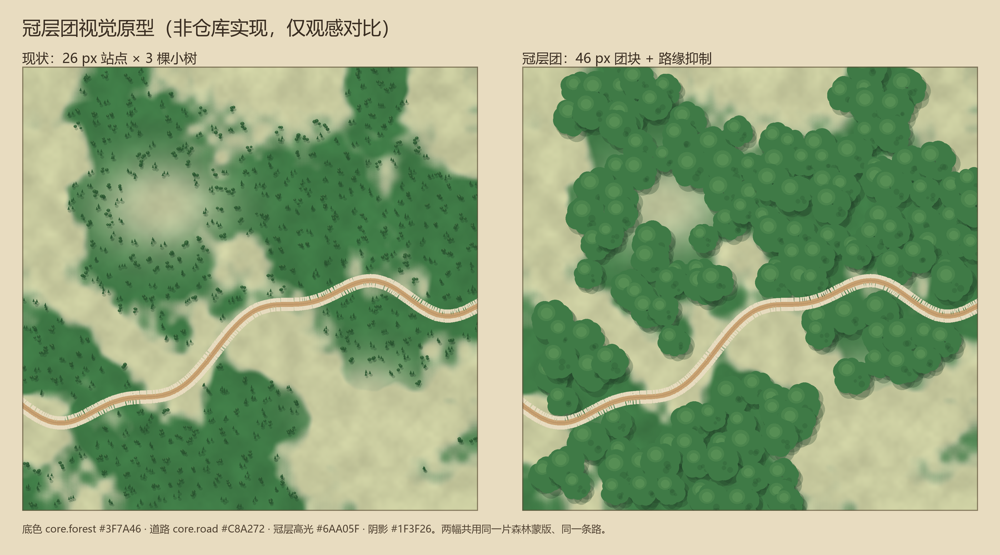

# Codex 方案评审（对照 World View 现有实现）

> 状态：**评审记录，非决策文档**。任何采纳项须经用户裁定；涉及架构的，另开 ADR。
> 评审对象：[`CODEX_INPUT.md`](CODEX_INPUT.md)（Codex 原文 + 2026-10-21 补件）。
> 评审基准：`README.md`、`AGENTS.md`、ADR-0012 / ADR-0037 / ADR-0043 / ADR-0045 / ADR-0048。
> 日期：2026-10-21。

---

## 0. 结论

1. 这是一份合格的「从零做 JRPG 地图编辑器」教程；作为独立方案自洽，但**不知道本仓库已有实现**。
2. 多数主题仓库已覆盖且更深；真正的新增点是 **气候场、森林密度、按 LOD 换图元、连续群系权重**。
3. 有 5 处不能照搬：**JSON 存储、f32 SoA 内存、Bevy 类型进数据层、全局 SDF、主题硬编码**。
4. 补件没有推翻结论，只把「森林 / 山地」从「加密度 / 加符号」修正为「**按 LOD 换图元**」。

---

## 1. 范围与方法

- **对象**：Codex 回答一～十八节 + 「最后一个关键建议」；补件 9 图 + 3 段代码（`TerrainCell`、`fbm`、项目树）。
- **方法**：逐节对照仓库实现与 ADR；只评审「与本仓库有关的可采纳性」，不评价其作为独立教程的质量。
- **证据**：`docs/codex-assets/` 9 图；`CODEX_INPUT.md` 的结构化转写；仓库代码与 ADR。
- **限制**：Codex 的代码块多为截图截断，行为判断以其文字描述 + 可见片段为准；未做逐行复现。

---

## 2. 总对照

| 主题 | Codex 方案 | 仓库现状 | 判定 |
|---|---|---|---|
| 数据模型 | 6 字段 AoS/SoA，`f32` 归一化 0..1 | 3 通道、4 B/格、`i16` 米 | 仓库更省；**气候字段是缺口** |
| 大陆 | 多层 fBm + Domain Warping + 海平面 | 作者包络 + SDF + 径向剖面 | 互补；Codex 对「两块大陆」无布局控制 |
| 海岸 | SDF + Marching Squares | SDF + fBm + MS + Chaikin/DP | 仓库领先曲线质量 |
| 海洋 | 4 个色带 + 岸线描边 | 7 层水岸 + 深度曲线 + 配方 | 仓库领先；**海底深度是缺口** |
| 群系 | 5 因子 + 16 枚举 | 高度分带 + 21 个开放编号 + 族 | **气候因子是缺口**；枚举是退步 |
| 混合 | 每格 4 权重 + shader | 离散槽位 + 双线性/柔化 | **连续权重是缺口** |
| 森林 | 密度蒙版 + 泊松采样 | 二值掩码 + 哈希抖动 + LOD | **密度/图元是缺口** |
| 山地 | 山脊曲线 + 高斯 + Ridged | 山脊曲线 + Ridged + 脊点吸附 | 大致持平；仓库装饰更细 |
| 雪山 | 温度 × 高度 smoothstep | 固定雪线阈值（2600 m） | **温度模型是缺口** |
| 河流 | 汇流 + `W=kA^α` | 意图笔刷拓扑挖深 | 取舍：自动 vs 手控 |
| Chunk | 256² + Dirty | 256² + 3 级 mip + 视口拣选 + 脏矩形 | 仓库领先 |
| 存储 | `world.json` + `.bin` | YAML + `terrain.bin` | **冲突 P3** |
| 撤销 | `EditCommand` before/after | `wv-edit` 命令 + History | 一致；仓库已集成 |
| 性能 | 400 MiB（实为 464） | 64 MiB | 仓库领先约 7× |

---

## 3. 五处硬冲突（P0，不能照搬）

### 3.1 存储：`world.json` vs P3 的 YAML

Codex 的 `world.json` + `height.bin` 把元数据写成 JSON。仓库 P3 明确「元数据、配置、矢量与所有对象一律 YAML」，二进制只留给超大地图网格。

- **照搬代价**：工程目录出现两套人类可读格式；`wv-io` 的 YAML round-trip 契约被撕开。
- **改法**：`world.yaml` + 同名 `.bin`；`style` 字段不进世界数据——它是主题（`ThemePack`）的事，不是世界事实。

### 3.2 内存：f32 SoA 是 6～7 倍开销

Codex 的 `TerrainMap` 用 5 张 `Vec<f32>`（高度/温度/湿度/坡度/海岸距离）+ RGBA8 权重 + u8 分类。4096² 下：

| 项 | 体积 |
|---|---|
| 5 × f32 | 320 MiB |
| RGBA8 权重 | 64 MiB |
| u8 分类 | 16 MiB |
| 实际相加 | **464 MiB**（Codex 写「合计 400 MiB」，算术有误） |

仓库的 [`TerrainCell`](../crates/wv-terrain/src/lib.rs#L72) 是 `(i16, u8, u8)` = 4 B/格，4096² 只有 **64 MiB**。坡度、岸距、气候都可以**派生**，不必存。

- **照搬代价**：内存 7 倍、`terrain.bin` 格式作废、所有读写/笔刷/校验跟着改。
- **改法**：保留 3 通道；气候与坡度在生成/烘焙时算，不进盘。

### 3.3 分层：Bevy 类型进了数据层

Codex 的 `TreeInstance`、`MountainInstance`、`DesertRegion` 里直接写 `Vec2`，并注明「`Vec2` 来自 `bevy::prelude`」。这在渲染层没问题，但仓库的 `wv-terrain` 是**零 Bevy** 的纯数据叶子（AGENTS §2.1）。

- **照搬代价**：`cargo tree -p wv-terrain | grep bevy` 立刻非空；数据层不能再独立跑 CLI / 测试。
- **改法**：数据层用 `(f32, f32)` 或自定义 `Vec2`；到 `wv-render` 边界再转 `bevy::math::Vec2`。

### 3.4 全局 SDF：会破坏增量 patch 契约

Codex 的 `D(x,y)=min‖(x,y)-p‖` 是对每个海洋像素求**全局**最近岸距离。仓库的 [`shore.rs`](../crates/wv-terrain/src/shore.rs#L35) 用**有界支撑**的多源 BFS，截断在 12～19 格，理由写得很清楚：填掉一个湾，湾内所有格的距离都会变；只有有界支撑，脏矩形 patch 才能与全图重算**逐字节一致**。

- **照搬代价**：每次笔刷都要全图重算距离场；ADR-0048 的「局部 = 全图」契约失效。
- **改法**：保留 BFS；带宽变化由 `SeaRecipe::field_radius()` 推导，场和脏区一起扩。

### 3.5 硬编码颜色：主题包退化

Codex 把 `DEEP_OCEAN`、`DESERT_BASE`、`SNOW_BASE`、群系色写死在 Rust/WGSL 里。仓库已把海、地形装饰、覆盖物抽成 `wv-theme` 的配方（`SeaRecipe` / `DecorRecipe` / `FeatureRule`），换主题零改渲染源码（ADR-0043 / ADR-0048）。

- **照搬代价**：水墨包、暮色包全部失效，回到「写死一套水彩」。
- **改法**：数值进配方，shader 只收 uniform；颜色从 `PaletteColors` 取。

---

## 4. 真缺口（P1，值得吸收）

### 4.1 气候场

仓库现在的分类是**高度优先**：[`band_surface_biome`](../crates/wv-terrain/src/continent.rs#L341) 先判雪/山/丘，再判森林/荒漠。`climate.rs` 只是一个固定模板（纬度 + 东部干旱带），不是逐格可编辑的温湿度场。

后果具体：

- 森林只铺在 300 m 以下，山上长不了树；
- 雪线只看高度，不看温度；
- 荒漠靠一个错位噪声，和真实气候无关。

Codex 的 `T = T_latitude - kH + N_T` 与 `moisture = fBm` 是正确方向。

**采纳方式**：先做「生成期派生」，不落盘——温度由纬度 + 海拔递减 + 噪声算，湿度由 fBm + 距水距离算；分类时用它们替换现在的两个掩码。等作者真的需要「手绘温度蒙版」时，再考虑加 `i8` 温度 + `u8` 湿度通道（v2）。

**成本**：中。改 `band_surface_biome` + `climate.rs` 模板路径；不动二进制格式。

### 4.2 单一 biome 装不下「叠加」

Codex 5.1 说「一个地方可以同时是高山地形、针叶林覆盖和积雪状态」——这句话是对的，但它的 `enum Biome` 做不到：`SnowMountain` 和 `Forest` 仍然互斥。仓库同样做不到：一格只能有一个 `biome`，高度带优先，所以「林覆丘」表达不了。

三条路：

| 方案 | 做法 | 代价 |
|---|---|---|
| A. 派生密度 | 生成/烘焙时按湿度+坡度+噪声算 `canopy`，只影响符号密度与压暗 | 零 schema；不可手绘 |
| B. 区域覆盖 | `Region.overlay = "dense_forest"`（ADR-0045 已有） | 只改符号；需扩密度倍率 |
| C. 第 4 通道 | `canopy: u8` 进 `TerrainCell`（v2） | 格式迁移；最正确 |

**建议**：先 A，B 作为作者手控补充，C 等「林相」成为事实需求再做。

### 4.3 连续群系权重

仓库的 [`display_kind`](../crates/wv-terrain/src/biome.rs#L144) 是「一格选一个 0–9 槽位」，边界靠双线性 + 柔化。Codex 的 4 权重混合能做出更自然的手绘过渡，但**每格存 4 个 f32 是 64 MiB**，不可接受。

**采纳方式**：只在**烘焙期**算权重——用高度/气候/噪声算 4 个权重，直接混进像素，不落盘。先在 `VectorFlat` 试点，对比截图；不动数据格式。

**成本**：中。改 `cells.rs` 的取色路径；主题配方要给出 4 个基色。

### 4.4 按 LOD 换图元（补件后修正）

两张森林图不是「疏/密」两档，而是两种画法 + 两个尺度：

| 图 | 实际是什么 | 含义 |
|---|---|---|
| 4.1 森林 | 羊皮纸上的单株墨线树，长投影、大量空地，区域/遭遇战尺度 | 仓库「每站 3 棵小树」方向对，尺寸/阴影不够 |
| 4.2 密林 | 俯视**树冠团块**：大块圆斑、左上高光、右下阴影，道路与空地穿插 | 不是「更多小树」，是另一种图元——冠层团 |

这修正了「加森林密度」的原始建议：**密度只解决疏林，解决不了密林**。仓库的 `DecorBand` 已有 26 / 46 / 72 px 三档，但 [`site_primitives`](../crates/wv-render/src/terrain_decor.rs#L207) 只改尺寸、不改形状。正确做法是按 LOD 换语法：

- **Edit 档**：森林族画冠层团（噪声边圆斑 + 顶点色高光/阴影）；山地画单峰；
- **Region 档**：退成树簇/三角；
- **Nation 档**：退成色块 + 稀疏符号。

这比新加密度通道便宜，也不动数据格式。4.2 里的道路/空地由矢量层压在上面，装饰只需在路缘做一次抑制，避免树冠顶到路肩。

### 4.5 海底深度（P3，暂缓）

Codex 的 `OceanData { depth, distance_to_coast }` 能表达「近岸深水、远海浅滩、海沟」，仓库只有一个高度场，深度 = 海平面以下的 `-height`，表达不了。但 JRPG 手绘风格用不到海沟；**除非要做海底山脉/海沟，否则不做**。

---

## 5. 仓库领先项（P2，不必回退）

| 能力 | 仓库 | Codex |
|---|---|---|
| 水岸层次 | 岸墨→泡沫→浅滩→排线→墨线→白弧，7 层配方 | 4 个色带 + 一条描边 |
| 岸距场 | 有界 BFS，patch 逐字节一致 | 全局 SDF，无增量契约 |
| 主题 | `SeaRecipe` / `DecorRecipe` / `PaletteColors` | 常量写死 |
| Chunk | 256² + 3 级 mip + 视口拣选 + 脏矩形 | 256² + Dirty，无 mip/拣选 |
| 等值线 | MS + 链装配 + Chaikin + DP | 只提 Marching Squares |
| 山地装饰 | 脊点吸附 + 尺寸抖动 + 30% 次峰 + 雪帽/露岩 | 沿脊采样 + 高斯，细节少 |
| 确定性 | 同 seed 逐位一致 + 单测 | 只提「种子要稳定」 |
| 内存 | 4 B/格 = 64 MiB | 464 MiB |

---

## 6. Codex 的具体问题（P3）

| # | 问题 | 证据 | 影响 |
|---|---|---|---|
| 1 | `fbm` 在 `octaves=0` 时 `value/total` = 0/0 → NaN | 代码块无 `octaves.max(1)` 保护 | 复制即坏 |
| 2 | 内存表 400 MiB 与四项相加 464 MiB 不符 | §十六 | 预算失真 |
| 3 | `TerrainCell.biome: Biome` 与 `TerrainMap.biome: Vec<u8>` 不一致 | §2.1 | 示例自相矛盾 |
| 4 | `Biome` 枚举把「水深带/高度带/地表覆盖」混为一谈 | `ShallowOcean` / `SnowMountain` | 降低地形后 biome 不更新，出现「雪山在海底」 |
| 5 | 泊松采样未提 chunk 接缝 | §6.2 | 分块后树在边界成排/成空 |
| 6 | 树木间距用屏幕像素，无 LOD | §6.2 | 缩放时密度跳变 |
| 7 | Marching Squares 未提缓存 | §3 / §12 | 4096² 每帧全图重算 |
| 8 | `style` 存进 `world.json` | §15 | 主题与世界事实耦合，违反 P5 |
| 9 | 高度归一化 0..1，坡度/距离失去物理单位 | §2.1 / §7.1 | 坡度不是坡角；换分辨率要重调所有阈值 |
| 10 | 岸距符号 `D<0 陆 / D>0 海` 与仓库相反 | §4.2 | 移植时的隐形陷阱（不是错，是约定） |

---

## 7. 补件后的修正

### 7.1 山地：三角符号是「Codex 的示意语法」

- **5.1 棕色山脉**：区域尺度的**皴线**——沿脊线的密集排线，不是三角符号；
- **5.2 雪山**：3/4 透视插画，不是俯视地图，仓库的俯视 2D 不可能直接复现；
- **7.2 示意图**：三角 + 雪帽 + 虚线脊线——恰好验证仓库现在的做法。

结论：三角符号是 Codex 自己的示意语法，不是 5.1/5.2 参考图的语法。要追 5.1，就在 Edit 档加「脊线排线」图元（`PrimShape::Hatch`，沿高度梯度定向）；要追 5.2，就是换 2.5D 视图，属于 ADR 级决策。

### 7.2 海洋：4.1 是示意图，对应 Schematic 而非 VectorFlat

4 条平色带（`#91A868` / `#E4D3A3` / `#6CAAA7` / `#234A70`）、波浪边、无纸纹/墨线/泡沫。它更像仓库的 Schematic 平涂视图，而不是 VectorFlat 的水彩。

- 仓库的 7 层水岸继续保留，不被 4 带替换；
- Codex 的 4 带可作为 Schematic 视图的海色配方（若该视图当前没有独立海色，这是一次低成本补齐）。

### 7.3 笔刷：HTML 原型，缺口在入口不在算法

| Codex 笔刷 | 仓库对应 | 状态 |
|---|---|---|
| 高度 | `Brush::raise_lower` / `paint` / `exact_fill` | 有 |
| 海洋 | 底图 `MapBase::Ocean` + 大陆架生成 | **缺独立入口** |
| 生态 | `mark_region` + biome 笔刷 | 有 |
| 山脉 | `Intent::MountainRange` / `MountainMassif` | 有 |
| 河流 | `Intent::River` / `Lake` | 有 |
| 装饰 | `Region.overlay` + Place 工具 | **入口分散** |

真正缺的是**海洋笔刷**（画陆地/海湾/岛屿/浅海）和**装饰笔刷的统一入口**，不是六个笔刷内核。HTML 原型可以借布局，不能借实现。

### 7.4 项目树：单 crate 模块清单，不是仓库分层

| Codex `src/` | 仓库 crate |
|---|---|
| `world/` | `wv-core`（map）+ `wv-terrain`（chunk/biome） |
| `generation/` | `wv-terrain` |
| `rendering/` | `wv-render` |
| `editor/` | `wv-app` + `wv-edit` |
| `persistence/` | `wv-io` |

可借的是 `generation/` 的细分：continent / noise / climate / mountains / rivers / forests / ocean。仓库现在 mountains/rivers/forests 都在 1907 行的 `intent.rs` 里，未来按这个清单拆文件是合理重构，但不是功能。

### 7.5 12.1 架构图：CPU 烘焙 vs GPU 驱动

这张图把一条更根本的分歧摆上台面：

| | Codex 12.1 | 仓库现状 |
|---|---|---|
| 地形上色 | GPU 着色器读 HeightMap / BiomeWeightMap / CoastSDF，实时混合 | CPU 烘焙成 RGBA8 纹理，GPU 只采样 |
| 主题切换 | 换 uniform，即时 | 重新烘焙全图（约 2.2 s） |
| 局部编辑 | 改数据纹理一小块，shader 自动重算 | 脏矩形 patch 烘焙，逐字节可对拍 |
| 可测试性 | 像素结果在 GPU，难逐字节断言 | 纯 Rust 函数，可直接哈希对拍 |

两条路线各有代价；仓库目前是混合的（底图 CPU 烘焙 + `VectorFlat` 水陆边 shader）。要走全 GPU 路线，是一次 ADR 级改动，不是 decor 层能解决的。

### 7.6 冠层团原型（2026-10-21）

左：现状（26 px 站点 × 3 棵小树）；右：冠层团（46 px 团块 + 路缘抑制）。两幅共用同一片森林蒙版、同一条路，只换图元。

观察：

- 冠层团确实能读出「密林」，路缘抑制也让道路两侧留出肩部；
- 但大面积平涂 mesh 与带纸纹的烘焙底图有**质感断层**——团块像贴纸；
- 现有 `terrain_decor` 是独立 mesh（Z 0.075），不参与底图的 soften / grain，因此 canopy 越大，断层越明显。

结论：B 的成本从「低」上调为「中高」。要落地，必须先二选一：

1. **烘进地形纹理**：在 `image_from_terrain` 里画 canopy，继承纸纹/柔化；失去独立 LOD 与开关，换主题要重烘。
2. **独立 mesh + 颗粒材质**：给 canopy 材质加纸纹噪声/顶点抖动；保留 LOD，但要新增材质路径。

在选定之前，不建议直接写 B。

---

## 8. 采纳建议与优先级

| 顺序 | 采纳 | 改动面 | 收益 |
|---|---|---|---|
| 1 | 气候场（生成期派生） | `band_surface_biome` + `climate.rs` | 森林不再只长在低地；雪线有温度依据；不动格式 |
| 2 | 冠层团（先定烘焙/材质） | 待定：`image_from_terrain` 或 canopy 材质 | 改善「密林」观感；原型已证明质感断层需先解决 |
| 3 | 连续权重（仅烘焙） | `cells.rs` + 主题配方 | 手绘过渡更像参考图 |
| 4 | 海洋/装饰笔刷入口 | `wv-app` UI + 现有 intent | 补 UI 缺口，不动算法 |
| — | 不采纳 | JSON、f32 SoA、全局 SDF、枚举 biome、硬编码色 | — |

> 原型后调整：冠层团从第 1 降到第 2；「烘进纹理 vs 独立 mesh」未选定前不动手。

**已降级**：泊松采样。参考图的树是「成簇 + 空隙」，不是均匀最小间距；仓库的哈希抖动反而更接近手绘。泊松只作为可选模式，需解决 chunk 接缝后再评估。

---

## 9. 待裁问题

以下需要用户裁定，裁定后才进 ADR / 基线；建议登记到 `README.md` §12。

1. **林相是否成为事实**：第 4 通道 `canopy: u8`（v2）还是派生密度？——决定要不要动二进制格式。
2. **渲染路线**：保持 CPU 烘焙，还是迁到 GPU 驱动？——决定主题切换/局部编辑/测试策略。
3. **冠层团归属**：默认主题就有，还是主题专属（`wv-theme` 新配方）？——美术方向。
4. **`intent.rs` 拆分**：是否按 mountains/rivers/forests/ocean 拆文件？——重构，不是功能。
5. **Codex 的 4 带海色**：是否作为 Schematic 视图的配方？——低成本，但需确认该视图现状。
6. **冠层团落地方式**：烘进地形纹理，还是独立 mesh + 颗粒材质？——决定 B 的成本与可开关性。

---

## 10. 资产与来源

- 原文：`CODEX_INPUT.md`（条目 1 为用户粘贴；条目 2 为 PDF 结构化转写）。
- 图片：`codex-assets/` 11 个文件（9 处图；第 4、5 处各两张）。
- PDF：`C:\Users\leo\Downloads\local-image-2026-10-21_8_14.pdf`（外部文件，未入库）。
- 代码：`TerrainCell`、`fbm` 与原文一致；项目树已补全。

---

## 11. 评审边界

- 本文不评价 Codex 作为独立教程的完整性，只评价「搬进本仓库」的适配性。
- 本文不替代 ADR：涉及格式/渲染路线的结论，必须另开 ADR。
- 本文的「仓库现状」以 2026-10-21 的 `main` 为准；后续改动需重新核对。

---

## 12. 实现记录（2026-10-21）

分支 `feat/climate-derived-fields` @ `5a0fdfe`（**未合入 main**）。

- 采纳 §8 第 1 项：新增 `climate_at` / `lowland_biome`，低地按温度/湿度分类；
  高地带仍走既有高度阈值，雪线/山/丘观感不变。
- 修复 `continent::fbm01` 的归一化：旧式 `v*0.5+1.0` 把 `[-1,1]` 映射到
  `[0.5,1.5]` 再钳制，导致森林/荒漠掩码**恒不命中**；改为 `(v+1)*0.5`，
  与 `climate.rs` 的既有实现对齐。
- `blended` 在海湾融合带保留低地气候群系；融合后 `h < 300` 的 `BIOME_NONE`
  按气候重新分类，避免海岸带出现大片「无群系」。
- 预览（`ReliefLevel::Hills`）：[`codex-assets/climate-preview-hills.png`](codex-assets/climate-preview-hills.png)。
- 已知限制：`ReliefLevel::Mountains` 的径向剖面把低地压成海岸环，气候带在
  Hills 档更明显；覆盖阈值是首轮标定值，视觉验收后再调。

### 12.1 外部评审回合（2026-10-21 深夜）

外部评审（全文收录在分支 `docs/reviews/2026-10-21-climate-derived-fields.md`，
已随 `0447265` 入库）裁决「方向正确，不建议按现状合入」，13 项。复核与处置：

- **A4（NONE 重分类块不可达）被实验证伪**：按评审建议移除块、改
  `debug_assert_ne!` 后，断言**立即触发**——评审的静态证明表漏了
  「原始高度 ≥300 → band 给 NONE → `blended` 压回 <300 保留 (LAND, NONE)」
  的交叉项；其探针 `NONE_low=0` 是因为测的是**带重分类块的旧代码**，
  属循环论证。块已恢复，并补块内断言与注释说明。
- **A1（雨林不可达）确认并修复**（`e958dc5`）：湿度动态范围 0.75→0.95、
  雨林湿度线 0.68→0.62；探针实测丛林 0 → **10.1%**。端到端测试升级为
  **逐类断言**（森林/草原/荒漠/苔原/丛林 + 低地 NONE==0）。
- **A6/A7 接受并修复**：干斑块分支合取 `moisture < 0.40`；
  `desert_cover = 0` 短路全部荒漠判定（0 真的等于 0）。
- **A11 接受**：历史重写为三条——`b348b8e` fbm01 修复（单独，注明
  海岸线迁移影响）/ `aab6ccb` 气候场 / `e738bf3` 剖面；最终树与被评审
  tip 逐位一致。
- **A3 接受**：GLOSSARY 两条、README §12-49/50、plan §8 追记、评审入库
  （`0447265`）。评审指出的悬空引用（`docs/codex-assets/` 不在分支上）
  一并修正。
- **A9 部分推回**：「贴岸死平」是加宽低地的目标本身；真问题是 0.8R
  折角，改 `denom = 1.0R` 把折角推到峰顶即可（待做）。
- **A2 / A10 / A5 转待裁**：已登记 README §12-49 / §12-50（含 A5 联带）。
- **A8（低地 44%）转视觉验收**：本轮预览见
  [`codex-assets/climate-preview-mountains.png`](codex-assets/climate-preview-mountains.png)
  与 [`climate-preview-hills.png`](codex-assets/climate-preview-hills.png)。
- 分支现共 6 个提交（`b348b8e` → `0447265` + `0de9baa` A9 折角修正），全闸门绿
  （wv-terrain 141 / workspace / app 227 / clippy / fmt）。**已合入 main**：
  merge commit `5b9a779`（2026-10-21），合并后 `cargo test -p wv-terrain` 141 全过。
