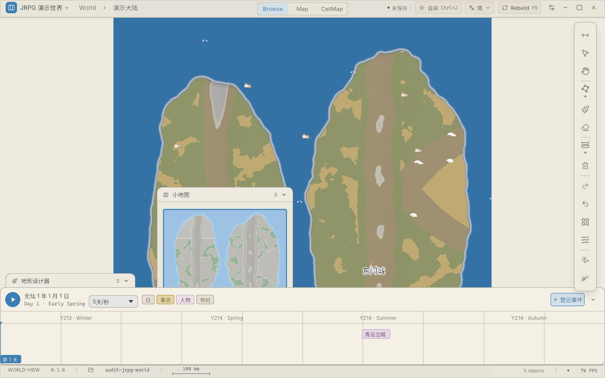
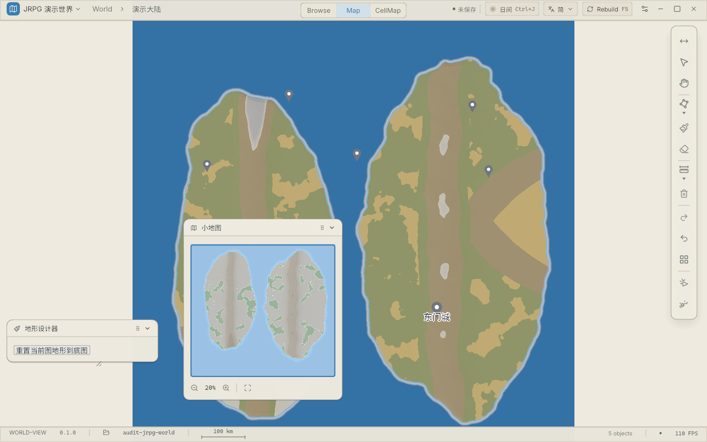
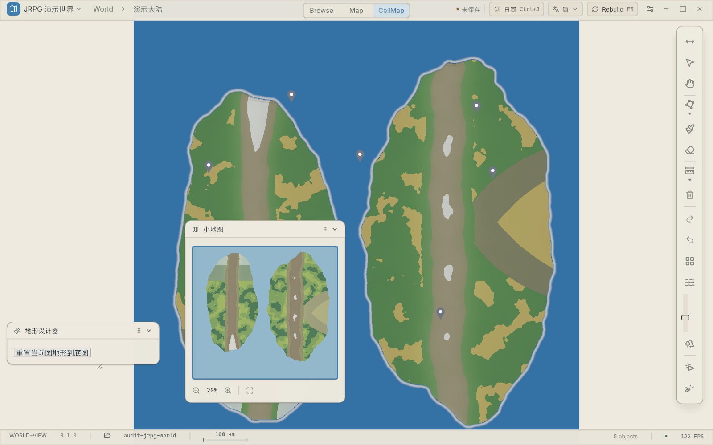
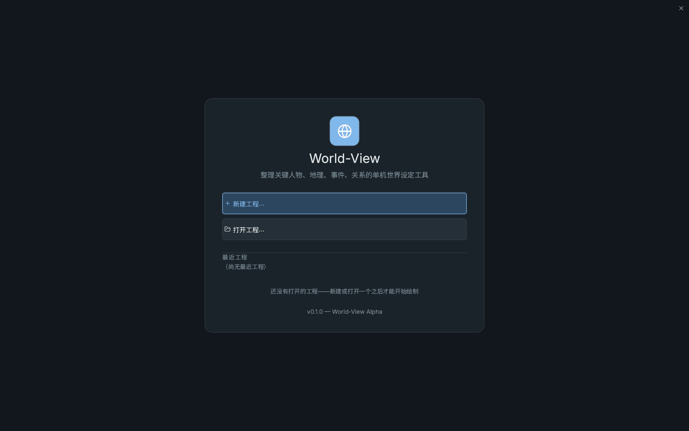

# World View 交互设计审计报告（2026-10-29）

> **性质**：点时审计快照（audit snapshot），不是基线规格、不是 ADR。文中全部改进建议均为**提案**，采纳与否待裁定；被采纳的项应各自走 ADR / 计划流程。
> **对象**：main @ 22db9dc · **方法**：四路并行全码审计（每条结论带 file:line）+ 实机截图取证（WV_SHOT 探针 + 演示工程副本，未污染仓库）。
> **证据截图**：本目录同级 `audit/2026-10-29/`，正文内联引用。

---

## 状态补注（2026-10-29 晚追写，2026-10-30 batch3 增补；正文各条原文不动，本节统一记进度）

**已修复（编号 → 落点）**：

| 编号 | 修复落点 |
|---|---|
| UX-001 | batch2=最小版（CloseConfirm 确认框 + dispatch 守卫 + 窗控 ×）；batch3=**60s 静默自动保存**（复用 dispatch_save_command，播放中/确认在途不抢跑）——**崩溃恢复仍待做** |
| UX-002（**样板**） | `AddEventCommand` + 「登记事件」对话框（时间轴按钮入口）；**人物 / 事态创建仍未建**，地点与参与者走 Inspector 补填 |
| UX-003 | 离屏相机 PNG 导出（`export_png.rs` 两拍状态机：第二台 Camera2d 渲 Image 目标，egui 不经它=无面板入镜；落 `<工程>/export/export-<ts>.png`） |
| UX-005 | 并行会话 ADR-0088 D1（刷地形命令选区蒙版，54e4051） |
| UX-009 | 工程菜单「面板」分组（**ADR-0087**，推翻 2026-10-19 裁定） |
| UX-010 | 主画布滚轮翻转为**上滚=拉近**（与小地图/行业惯例同向）+ **Ctrl 短路**（相机缩放让位笔刷半径，双消费定案修复）+ 方向测试翻转 |
| UX-011 | 时间轴年份行按区间与历法真实派生（`year_segments`，>10 年抽稀）；季节改历法真实月份；空态引导替代 Border dispute 等 Figma mock |
| UX-012 | 根因钉死=遗留线迁移从不落盘（模板世界恒触发）→ 迁移后自动增量保存；回归测试在 `road_sync` |
| UX-021 | dirty pill dirty 态可点=保存（干净态保持展示——点击会走全量重写） |
| UX-024 | 双击容差从 6 世界单位改 **12 屏幕像素**（`DOUBLE_CLICK_SLOP_PX`，任意缩放档手抖余量一致） |
| UX-025 | Inspector 空态 Regions 计数从 `distances.places.len()` 改 `world.regions.len()` |
| UX-029①② | 笔刷入口灰化 + 光标禁止符；大陆框无选区禁用 + 成功才关框 |
| UX-030 | 工具入口四处灰化替代隐藏（icon_tile enabled 参数） |
| UX-032 | pick_place_pin 走 `poi_visible_at_rank` 单真源 |
| UX-034 | History MAX_UNDO=300 + 逐出状态栏回执 |
| （清单外）选项条盖顶栏 | **建议编号 UX-035**：egui 0.36 Panel 无跨系统堆叠，选项条叠回 y0..38 盖住顶栏、中段 Area 反挡软度滑条——已修（`root_ui_below_top_bar`，用户实机发现） |

**仍未完成**（详见正文各条与 round-2 路线图）：UX-001 崩溃恢复、UX-002 剩余实体（人物/事态/势力）、UX-004 拖拽预览、UX-006/007/008、UX-013..020、UX-023、UX-026..028、UX-031、UX-033、UX-027。

**round-2 修正项落定**：UX-010 双消费定案确认（`camera_zoom` 无 Ctrl 检查）→ batch3 修复；UX-017 收窄（海拔已手势帧提交，仅地表/群系每击一命令）；UX-022 撤回、UX-023 降 P3；UX-021/009 按减法化修法落地。

**新入册待办（建议编号）**：**UX-036** `wv gui -m <绝对路径>` 加载失败（os error 3；相对路径与菜单手动打开正常，2026-10-29 实测，根因待查）。

**待验证仍悬**：UX-020 死边真因（面板 1280 手排预算假设，需 DPI 实测）；UX-034 实际内存曲线（结构与上界已实锤，速率未实测）。

---

## 〇、证据基础与无法确认的部分

**已采用的证据**（按强度排序）：

1. **四路并行全码审计**（壳层与信息架构 / 导航与相机 / 地形与笔刷 / 图层对象与数据面板），每条结论带 `file:line`，覆盖 `wv-app/src/ui/`（35 个面板文件）、`wv-ui`、`wv-render`、`wv-edit`、`wv-io` 的交互路径；
2. **实机截图 5 张**（欢迎页 / Browse / Map / CellMap / 干净启动复测），经 `WV_SHOT` 探针取得；
3. 项目自身规约（AGENTS.md 七原则、V1/V2 裁定、ADR-0033/0038/0057/0058/0070/0078）、UI 规格文档（`.figma-ref/ui-design-prompt-2026-10-16.md`）、图层渲染规格（`docs/MAP_LAYER_RENDERING_SPEC_v0.1.md`）。

**无法确认 / 待验证清单**（均已标注，不计入缺陷）：

- 各项性能数字（48ms 重打包、3ms 指纹、75ms isoline）来自代码注释，本次未实测；
- Ctrl+滚轮是否真的「同时缩放+改笔刷」：两个系统各自消费 `MouseWheel` 且 `camera_zoom` 无 Ctrl 检查（`camera.rs:146-223` vs `camera.rs:447-468`），静态读码高度可疑，需实机验证；
- 触控板（`MouseScrollUnit::Pixel`）手感、DPI/多显示器表现：无代码处理（全仓无 scale_factor 逻辑），未实测；
- 「打开工程即未保存」的根因（现象已实机证实三次，见 UX-012）；
- 个别面板（inspector 之外）的 i18n 硬编码未逐文件穷尽。

---

## 一、总体评价

### 综合评分：56 / 100

| 维度 | 满分 | 得分 | 一句话判据 |
|---|---:|---:|---|
| 信息架构 | 10 | **5** | 浮窗自由但不可停靠、面板发现性差、三种视图两名三叫、保存无鼠标入口 |
| 地图导航 | 10 | **7** | 指针锚定缩放+缩放跨级+比例尺是专业级的好；扣在小地图滚轮反向、无书签/搜索定位、面包屑不可点 |
| 地形编辑效率 | 15 | **9** | CellMap 批量编辑+实时预览+一笔一撤销是亮点；世界级笔刷零拖拽预览、参数不持久、海拔工具未接 UI |
| 图层与对象管理 | 10 | **4** | 双重显隐开关合取、无重排/重命名/分组/搜索、锁定是装饰、地图树无重命名 |
| 交互一致性 | 10 | **5** | 滚轮两处反向、两套选区两套行为、撤销粒度不一、E 键语义漂移、中英文同屏 |
| 操作反馈与容错 | 10 | **5** | 撤销白闪/校验不阻止/加载遮罩做得对；但关窗零确认+无自动保存+「打开即未保存」瓦解了整套安全叙事 |
| 专业工作流 | 15 | **7** | 产品自称「整理人物、事件、关系」，但这三类实体 GUI 无法创建；导出未实现；大陆生成工作流是真正的亮点 |
| 视觉可读性 | 10 | **7** | 令牌系统完整、双主题、截图观感专业；16 块纯图标瓷砖全靠 tooltip、小地图默认压在画布内容上 |
| 大地图适应性 | 10 | **7** | LOD 三档+密度预算+rank 硬门+GPU 场管线+增量补丁，底子好；阈值绝对化、大编辑 48ms 停顿 |

### 先说做得对的（有证据的合理之处）

1. **缩放体系是专业水准**：滚轮以指针为锚（`camera.rs:193-222`），缩放区间按每张图的幅面现算而非全局常量（`zoom_level.rs:134-141`），撞外界继续外滚回父级、进城的唯一手势是双击钻入图标（ADR-0038）——这套「每级一词」的语义比多数独立编辑器干净。
2. **撤销模型正确**：一次拖拽=一条命令=一个事务=一次 Ctrl+Z（`stroke.rs:111-114`），`History::undo` 整事务原子回滚（`history.rs:141-151`），提交失败逆序回滚，撤销后变化格 250ms 白闪回执（`dispatch.rs:591-597`）。外间传闻「undo 拆开一组操作」与代码不符。
3. **V1 守约彻底**：校验三处声明并实测不阻止保存（`validation_panel.rs:8,228-230`、`dispatch.rs:723-806` 无拦截）；错误/提示分列 E/H 徽章。
4. **大陆生成工作流**：8 参数单面板、骰子重骰、提交为一条 `GenerateContinentCommand` 宏命令「一撤全回」（`terrain.rs:227-319`）——这是全产品最成熟的一条创作流。
5. **比例尺与坐标**：1-2-5 候选 24 档、<1km 自动切米、tooltip 附格分辨率（`map_scale_bar.rs:35-38,124-135`），经纬度读数与 ADR-0034 上北下南约定一致。
6. **i18n 骨架**：639 Key 双语全覆盖（`keys.rs:25`），残片是局部问题（UX-018）而非系统性缺失。

### 回答元问题：以「地理数据编辑」为中心，还是以「绘制地图」为中心？

**产品已经用行动回答了：数据中心，而且这个选择是对的。** 欢迎页文案「整理关键人物、地理、事件、关系的单机世界设定工具」、YAML 单一真源、P7 时间轴、V1「校验只提示不阻止」——这是与 Inkarnate/Wonderdraft 类绘画软件的**差异化定位**，不应动摇。

**但当前的真实病灶不是「两心混杂」，而是两个半边各缺一块：**

- **数据侧缺「写」**：事件、人物、事态（以及势力本体）在 GUI 里**没有任何创建入口**——时间轴的「+ 登记事件」只打开一个只读列表面板（`timeline.rs:306-309`），面板空态的「登记事件 →」文字也没有接点击（`list_panels_panel.rs:102-110`）。数据为中心的软件，数据的创建却断了。
- **绘制侧缺「出」**：Ctrl+E 只弹「导出尚未实现」（`dispatch.rs:123-129`）。画得再好，成品拿不出这个软件。

所以裁定建议是：**守住数据中心骨架，补齐「叙事实体创建」与「导出管线」两端，而不是转向绘画工具**。同时用「工作区矩阵」把三个视图的职责边界讲清楚（见第四部分）。

---

## 二、缺陷清单

### P0 / P1 详述

---

**问题编号：UX-001**

- **问题名称**：关闭工程 / 关闭窗口零确认，且无自动保存
- **所在界面或功能**：顶栏 ×、Ctrl+W、工程菜单「关闭工程」
- **问题类型**：交互缺陷 + 功能缺失
- **严重程度**：**P0**（不可逆数据丢失）
- **证据来源**：`ui_shell/dispatch.rs:87-108`（CloseProject 直接 `world = World::default(); dirty = false`，对 dirty 零检查）、`top_bar/window_controls.rs:102-105` 与 `welcome_screen.rs:175-177`（直接 `AppExit`）；全仓 grep `auto_save/autosave` 零命中
- **当前行为**：dirty 状态下关工程/关窗立即丢弃一切；撤销栈随进程消失
- **预期行为**：dirty 时三出口均弹「保存 / 不保存 / 取消」；或自动保存兜底使确认变得次要
- **用户受到的影响**：数小时手绘地形因误点一个像素宽的 × 全部蒸发；且唯一的警示（顶栏「● 未保存」圆点）因 UX-012 长亮而被训练成背景噪音
- **根本原因分析**：把保存责任完全交给了用户，而警示信号本身又不可交互、不可点击、失真
- **推荐改进方案**：①dirty 拦截三出口；②60s 定时脏保存——`save_world` 本就是脏路径增量路由（`project.rs:892-1081`），自动保存的增量成本与一次 Ctrl+S 相同；③启动时检测崩溃残留的 autosave 提示恢复
- **替代方案**：只做关闭确认（半天工作量，挡住最痛的一刀）
- **实施成本**：低（确认窗）/ 中（autosave + 恢复）
- **验收标准**：改一格 → 点 × 出现拦截；任务管理器杀进程 → 重启可恢复 ≤60s 前的全部编辑
- **如何验证有效**：演练「画 30 分钟→误关」场景零丢失

---

**问题编号：UX-002**

- **问题名称**：事件 / 人物 / 事态（及势力本体）在 GUI 无任何创建入口
- **所在界面或功能**：时间轴「+ 登记事件」、事件/人物列表面板、势力层页签
- **问题类型**：功能缺失（核心流程断裂）
- **严重程度**：**P0**（产品的核心承诺无法完成）
- **证据来源**：`timeline.rs:306-309`（按钮只 `set_visible(Panel::Event, true)`）；`list_panels_panel.rs:102-110`（空态「登记事件 →」返回值被丢弃，不可点）；grep `AddEvent|AddSituation|events.push` 在 wv-app 零命中；势力创建空态提示「在工程目录下编辑 factions/*.yaml」（`inspector/layers.rs:196`）
- **当前行为**：三类叙事实体只能手编 YAML，编完才能被 Inspector 选中编辑
- **预期行为**：从时间轴或列表面板直接登记实体（名称/跨度/地点/参与者），落 `AddEventCommand` 等命令
- **用户受到的影响**：新用户第一次点「+ 登记事件」走进死胡同；Inspector 的事件表单因此基本不可达。产品标题里的「事件、关系」半边是空的
- **根本原因分析**：登记面板退役迁 Inspector 页签时只迁了读侧，写侧从未建成
- **推荐改进方案**：「+ 登记事件」改为弹出创建表单（复用 Inspector event_form 的字段组件），wv-edit 新增 `AddEventCommand`（YAML 落盘目录 `timeline/events/` 已存在）；人物/事态同构跟进
- **替代方案**：先只打通「事件」一个实体作为样板
- **实施成本**：中
- **验收标准**：纯 GUI、不碰 YAML，从零登记一个带参与者与地点的事件，并出现在时间轴事态层与校验面板
- **如何验证有效**：新用户任务「登记一场战争」可 5 分钟内无文档完成

---

**问题编号：UX-003**

- **问题名称**：导出未实现，创作无出口
- **所在界面或功能**：Ctrl+E / 工程菜单「导出」
- **问题类型**：功能缺失
- **严重程度**：P1（按「关键流程无法完成」可上探 P0）
- **证据来源**：`dispatch.rs:123-129` 弹「导出尚未实现：需要先定导出格式（PNG / SVG）」；`i18n/table.rs:511`
- **当前行为**：无任何出图能力
- **预期行为**：至少能导 PNG
- **用户受到的影响**：地图制作的最终交付物拿不走；用户被迫截屏拼凑
- **根本原因分析**：导出格式悬而未决（v0.2 §G 待裁），但 PNG 一档其实不依赖该决议
- **推荐改进方案**：第一期直接复用现成截屏管线（`WV_SHOT` 同款 `Screenshot::primary_window().observe(save_to_disk)`）：导出前一帧隐藏全部浮窗/工具条，按当前视图出 1×/2×/4× 分辨率 PNG。矢量导出另开 ADR
- **替代方案**：无（这是必须项）
- **实施成本**：低（PNG 一帧）
- **验收标准**：导出 4K PNG 无面板入镜、色彩与画布一致
- **如何验证有效**：导出图可直接用作跑团/出版物插图

---

**问题编号：UX-004**

- **问题名称**：地形笔刷拖拽全程零预览
- **所在界面或功能**：世界级地形笔刷（涂/擦/五意图）在 Browse/Map 档
- **问题类型**：交互缺陷
- **严重程度**：P1
- **证据来源**：`camera.rs:35-39`（`ActiveStroke` 只存点列，全仓无渲染系统消费它）；`edit/editing/stroke.rs:27-29`（仅松手提交）；对照 CellMap 路径有实时预览（`cellmap_bridge.rs:2243-2300`，红橙 α0.26 待落格）
- **当前行为**：拖拽中只有静态双环光标，松手才一次性生效
- **预期行为**：拖拽中实时显示将要写入的格子/形状
- **用户受到的影响**：涂一片森林要松手才知道大小形状，画错重来的次数翻倍；同软件两条笔刷路径行为不一致，心智模型分裂
- **根本原因分析**：世界笔刷走「采样→松手合成命令」架构，预览从未被列为需求
- **推荐改进方案**：wv-render 加一个消费 `ActiveStroke` 的预览 mesh 系统（点列+半径合成 footprint 半透明填充，配色语言与 CellMap 预览统一）
- **替代方案**：最低成本——拖拽期把已采样格即时写入临时高亮层
- **实施成本**：中
- **验收标准**：拖拽全程可见将写入格，松手前后形状一致
- **如何验证有效**：盲画一个圆形森林，一次成形的偏差 ≤1 格

---

**问题编号：UX-005**

- **问题名称**：地形笔刷绕过选区蒙版
- **所在界面或功能**：地形笔刷 vs CellSelection / 矢量选区
- **问题类型**：交互缺陷（保护机制失效）
- **严重程度**：P1
- **证据来源**：`edit/editing/stroke.rs:84-108`（直接按点列+半径落 `Brush`，不与任何选区求交）；对照 `edit/cell_stroke.rs:57-71`（EditCell 落笔 = 圆盘 ∩ 选区）
- **当前行为**：CellMap 里圈好选区后切 B 笔刷，照样改到选区外
- **预期行为**：存在激活选区时，所有写工具都应被蒙版约束
- **用户受到的影响**：「选区保护」只在部分工具成立；精心圈好的海岸线被一笔涂穿
- **根本原因分析**：蒙版逻辑写在 EditCell 工具内而不是写路径的公共层
- **推荐改进方案**：把「∩ 激活选区」下沉到 `commit_stroke` 公共层（有选区才生效，无选区行为不变）
- **替代方案**：在笔刷激活且存在选区时，光标圈外圈显示金色（已有选中钉视觉语言）提示受约束
- **实施成本**：低-中
- **验收标准**：有选区时任何写工具只在选区内落格；选区外一圈不产生脏路径
- **如何验证有效**：圈 100 格选区，乱涂 10 笔，选区外零变化

---

**问题编号：UX-006**

- **问题名称**：图层显隐双开关合取，锁定（locked）无消费者
- **所在界面或功能**：图层面板（声明层行 + 7 个会话胶囊开关）
- **问题类型**：交互缺陷（语义打架）
- **严重程度**：P1
- **证据来源**：`layer_frame.rs:158-164`（`visible = 会话开关 && layer.visible` 双重合取）；`streets.rs:375-379` 是全仓唯一 locked 消费者；`MAP_LAYER_RENDERING_SPEC_v0.1.md:230` 自认「locked 仍无消费者」；`layers_panel.rs:300-321` 两层开关并存
- **当前行为**：道路看不见时，用户不知道该开声明行眼睛还是会话 Road 开关；点了锁笔刷照样改
- **预期行为**：每类对象只有一个显隐控制点；锁定对所有写工具生效
- **用户受到的影响**：排障成本高（关了一个另一个还亮着）；「锁定」给出虚假安全感
- **根本原因分析**：v0.3 会话轴与 ADR-0013 声明轴两次迭代叠加，未做收敛
- **推荐改进方案**：会话开关并入声明层（Terrain Smooth 等渲染参数移到对应层的展开区）；locked 下沉到写路径公共层拦截（与 UX-005 同一落点）
- **替代方案**：短期先在会话开关旁标注「临时（不保存）」
- **实施成本**：中
- **验收标准**：任一对象类显隐只有一个控制点；locked 层上所有写工具拒绝并 toast 说明
- **如何验证有效**：新用户 30 秒内独立完成「隐藏道路→只显示河流」

---

**问题编号：UX-007**

- **问题名称**：图层顺序 / z 无 UI，面板「DRAW ORDER」是死文案
- **所在界面或功能**：图层面板
- **问题类型**：功能缺失
- **严重程度**：P1
- **证据来源**：`wv-edit/src/command/overlay.rs:66-69`（z 与 source 明确不在 `UpdateLayerCommand` 范围）；`layers_panel.rs:96-102`（新建钮不画、无上下移控件）；`layer_frame.rs:151-157`（多同 kind 层只认第一个声明，用户无从知晓）
- **当前行为**：改图层顺序只能手编 `maps/<id>/index.yaml`
- **预期行为**：面板内拖拽/↑↓ 重排，顺序即绘制序
- **用户受到的影响**：审计维度「图层顺序与渲染结果一致」无法满足——用户根本改不了
- **根本原因分析**：Z 槽位采用「内建槽位 ±0.05 微调」架构（`layer_frame.rs:28-34`），有意不让作者全权排序，但没给替代出口
- **推荐改进方案**：加 `MoveLayerCommand`（重排声明序，渲染按声明序插内建槽位之间）；`z_offset` 作为行内高级字段（势力层已有 DragValue -4..=4 先例，`faction_panel.rs:241-246`）
- **替代方案**：至少把「顺序=声明序、同 kind 取第一个」两条规则写进面板脚注
- **实施成本**：中
- **验收标准**：不碰 YAML 完成一次「标签移到道路之下」并渲染正确
- **如何验证有效**：与手编 YAML 的结果逐位一致

---

**问题编号：UX-008**

- **问题名称**：面板显隐 / 折叠 / 密度的持久化是「写而不读」的假持久化
- **所在界面或功能**：ui-layout.yaml 全链路
- **问题类型**：交互缺陷（静默失效）
- **严重程度**：P1
- **证据来源**：`ui_shell/layout.rs:54-103`（打开工程只回灌 theme/map_theme/language/map_dock/时间轴折叠，**从不读回 `PanelLayout.visible`**）；`ui_layout.rs:174` 强制 `l.visible = panels.is_visible(panel)`；折叠 Id 不一致——持久化读 `id.with("collapsing")`（`layout.rs:169-174`）而实际状态存 `id.with("head")`（`wv-ui/src/widgets/floater.rs:210`）；密度「写盘不读回」`layout.rs:28-31`
- **当前行为**：用户摆好 12 个面板、折叠好、切好密度，重启后显隐回默认三项、折叠全开、密度回 cozy——每帧还在认真把 `visible` 写盘
- **预期行为**：退出时什么样，进来还是什么样
- **用户受到的影响**：每天开工第一件事是重新摆面板；且用户会误以为「上次没保存布局」是自己操作失误
- **根本原因分析**：几何真相在 egui memory（`layout.rs:13-16`），visible/collapsed 的回灌路径从未接上；两处 Id 字符串各写各的
- **推荐改进方案**：①回灌 `visible`（注意与 CellMap 工作区快照的互斥，守卫已有先例 `layout.rs:149-154`）；②统一折叠 Id；③density 读回或先藏起入口
- **替代方案**：无
- **实施成本**：低
- **验收标准**：重启后 12 面板的显隐/折叠/位置与退出时一致；yaml 里不再有 write-only 字段
- **如何验证有效**：连续开关应用三次，布局零漂移

---

**问题编号：UX-009**

- **问题名称**：面板开启入口过深，「图层化编辑」（P5 原则）的入口最难找
- **所在界面或功能**：设置对话框 / 项目菜单 / 命令面板
- **问题类型**：信息架构缺陷
- **严重程度**：P1
- **证据来源**：12 面板完整开关**只在**设置对话框（`settings_dialog.rs:90-102`）；项目菜单刻意不含（`project_menu.rs:65-66` 注释「2026-10-19 用户裁定」）；Layers/Validation 默认隐藏且无快捷键（`state.rs:490-492`）；「势力」已是 Inspector 页签但旧菜单名仍存在
- **当前行为**：新用户要找到图层面板：Ctrl+K（需要知道有命令面板）→ 搜「图层」，或打开设置→浮动窗口→勾选
- **预期行为**：≤2 次操作可达任意面板
- **用户受到的影响**：P5 是七原则之一，入口却埋得最深；图层/校验两个高价值面板长期无人发现
- **根本原因分析**：入口被裁撤后（项目菜单）没有补等价发现面
- **推荐改进方案**：顶栏右区加「面板」按钮（或右键画布空白）弹 12 项清单；Layers 默认可见（地图编辑器的图层面板是第一公民）
- **替代方案**：命令面板把「面板」组排到搜索结果最前
- **实施成本**：低
- **验收标准**：冷启动新用户 ≤3 次操作打开图层面板（用户任务表第四项达标）
- **如何验证有效**：5 人可用性测试全部自主找到

---

**问题编号：UX-010**

- **问题名称**：滚轮语义冲突：主画布与小地图方向相反；Ctrl+滚轮疑似双消费
- **所在界面或功能**：主画布缩放 / 小地图缩放 / 笔刷半径
- **问题类型**：交互缺陷（一致性）
- **严重程度**：P1
- **证据来源**：主画布上滚=拉远（`camera.rs:183`，`y>0 → factor>1`，测试注释 `camera.rs:632` 自证）；小地图上滚=拉近（`minimap_panel.rs:143-151`，`exp(-0.116)≈×0.89`）；`brush_radius_scroll`（`camera.rs:447-468`）与 `camera_zoom`（`camera.rs:146-223` 无 Ctrl 检查）各自持有独立 `MouseReader`——**待验证**；`MouseScrollUnit` 未区分，触控板一帧可顶满 ×2 钳制
- **当前行为**：同一根滚轮两处反向；笔刷开着时 Ctrl+滚轮可能一边缩放一边改半径
- **预期行为**：全局统一「上滚=拉近」（或至少同向）；Ctrl 按下时相机缩放短路；按滚动单位归一
- **用户受到的影响**：肌肉记忆互斥；触控板用户遭遇跳变缩放
- **根本原因分析**：两个系统独立演进，无全局输入语义表
- **推荐改进方案**：统一方向 + `camera_zoom` 增加 Ctrl 短路 + `MouseScrollUnit::Pixel` 换算
- **替代方案**：若「上滚=拉远」是有意致敬某软件，至少把小地图改成同向
- **实施成本**：低
- **验收标准**：主画布与小地图同向；笔刷激活时 Ctrl+滚轮只改半径
- **如何验证有效**：实机 A/B 各滚 10 次，无一次反直觉

---

**问题编号：UX-011**

- **问题名称**：时间轴 mock 数据与真实数据同屏混排
- **所在界面或功能**：时间轴面板（年份行、空态块、季节）
- **问题类型**：交互缺陷（信息失真）
- **严重程度**：P1
- **证据来源**：`timeline.rs:106-111`（`YEAR_SEGMENTS = ["Y213 · Winter",…]` 硬编码）；`timeline.rs:729-744`（空态画 "Border dispute"/"Market opens" mock 块）；`timeline.rs:866-876`（90 天等分假季节）；**截图证实**：日期主行显示「无仙 1年 1月 1日」（自定义历法），其下方年份行赫然是 Y213·Winter——同屏自相矛盾
- **当前行为**：作者无法分辨哪些是数据、哪些是占位
- **预期行为**：年份行从时间轴 range 与历法真实推算；无数据画空态
- **用户受到的影响**：把 mock 当真实数据做创作决策，或以为日期系统坏了
- **根本原因分析**：Figma 设计稿像素级复刻时把占位文案一并搬进了生产代码
- **推荐改进方案**：年份行按 `axis` 与当前历法生成刻度；空态改为「登记第一个事态 →」引导（与 UX-002 联动）
- **替代方案**：mock 区域统一盖「示例」水印
- **实施成本**：低
- **验收标准**：任意工程的年份行与该工程历法一致；空态无假数据
- **如何验证有效**：jrpg 工程（无仙历）与广东工程（公历）各截图对比


---

**问题编号：UX-012**

- **问题名称**：打开工程即显示「未保存」，警戒信号失真
- **所在界面或功能**：顶栏脏标记
- **问题类型**：交互缺陷（反馈失真）
- **严重程度**：P1
- **证据来源**：**实机三连证实**——`shot_map.png`、`shot_cellmap.png`、`shot_clean.png`（无探针干净启动）均显示「● 未保存」；而 `projection.dirty` 只由 `EditHistory::commit` 置位（`layers_panel.rs:344-348` 等统一配方）→ 加载路径上存在一次隐藏的 commit
- **当前行为**：用户没碰任何东西，软件就说改过了
- **预期行为**：打开未改动的工程显示「已保存」
- **用户受到的影响**：双重伤害——警报常鸣让用户学会无视脏标记（直接反噬 UX-001 的最后一道防线）；且用户永远不知道「我到底改了什么」
- **根本原因分析**：嫌疑为加载路径的修复性命令（派生河流、声明层补齐或地形生成）走了 commit 而未豁免 dirty
- **推荐改进方案**：定位该 commit 并改为加载期静默（提交但不记 dirty，或加载完成后重置 dirty）
- **替代方案**：无
- **实施成本**：低（定位后一行级修复）
- **验收标准**：打开 examples/jrpg-world 显示「已保存」；改一格后变「未保存」
- **如何验证有效**：连续开关工程十次，脏标记只在真实编辑后点亮



---

### P2 / P3 速览（同一模板的压缩呈现）

| 编号 | 问题名称 | 位置（file:line） | 当前行为 → 预期行为 | 类型 | 成本 |
|---|---|---|---|---|---|
| UX-013 | 高危删除零确认 | `inspector/faction.rs:354-359`（删势力一键直删）；`map_tree.rs:491-524`（purge 走 `apply_detached` 绕过撤销栈） | 一击直删（仅靠 Undo）→「删除势力/彻底删除」两步行内确认（垃圾桶 purge 已有两步先例 `map_tree.rs:625-639`，推广即可） | 交互缺陷 | 低 |
| UX-014 | 面包屑不可点、恒两段 | `top_bar/bar.rs:152-174`（纯 label）；`ui_time.rs:100`（恒返回 `["World", 当前图]`）；`DrillToSegment/Root` 命令齐备无 UI 消费 | 三级以上路径的中间级既看不见也点不了 → 面包屑可点化、显示完整链 | 交互缺陷 | 低 |
| UX-015 | 快捷键与文档漂移、RealTerrain 成孤儿 | E 键原测量橡皮现地形橡皮（`shell.rs:147-151`）；快捷键 3/Faction 死条目（`bar.rs:199-201`、`wv-render/state.rs:180` `BROWSING` 只剩 2 项）；RealTerrain 仅 HTTP 可达（`state.rs:570`）；无快捷键速查表 | 文档与注册表同步 + `?` 键弹速查浮层 | 交互缺陷 | 低 |
| UX-016 | 笔刷参数不持久 | `wv-render/state.rs:563`（`BrushState` 会话态不写盘） | 重启回默认半径/材质 → 并入 ui-layout.yaml（有现成持久化通道） | 功能缺失 | 低 |
| UX-017 | 单格编辑每击一撤销单位 | `inspector/cell.rs:348-356`（「即改即提交，每格 1 command」） | 点 N 格要 N 次 Ctrl+Z，与批量区单命令粒度不一致 → 表单会话 500ms 合并或显式「应用」 | 交互缺陷 | 中 |
| UX-018 | i18n 残片 | `command_palette_window.rs:84,93`（英文界面下占位符仍是中文）；`project_load.rs:185-236`；`status.rs:379-406`；`bar.rs:179` | 同屏混排 → 补 Key（双语表结构已就绪） | 视觉/文本 | 低 |
| UX-019 | 校验 E 行不可点，H 行反而可点 | `validation_panel.rs:252-258`、`diagnostics_bridge.rs:19-22`（CoreError 不携带 anchor） | 最需要跳转的悬空引用错误恰恰点不动 → CoreError 附 map/day 锚点 | 交互缺陷 | 中 |
| UX-020 | 画布占比：小地图默认压内容 + 两侧死边 | 默认位 [332,396]（`state.rs:328-368`）；截图证实小地图横在左岛中央，1600px 窗口两侧各约 300px 米色死边 | 小地图默认挪右下角；死边区色改中性或可点击平移 | 视觉问题 | 低 |
| UX-021 | 保存无鼠标入口 | `project_menu.rs:64`（刻意不进菜单）；全 UI 无 Save 按钮 | 不会 Ctrl+S 的用户找不到保存 → 顶栏右区加保存钮（兼作 UX-001 拦截入口） | 交互缺陷 | 低 |
| UX-022 | LOD 阈值绝对化 | `wv-render/state.rs:400-402`（Region=1.0 / Nation=3.0 固定 scale） | 城市图全览落在 Region 档、世界图全览落在 Nation 档，「看全图」不同档 → 阈值改为相对当前图 fit 的比率 | 交互缺陷 | 中 |
| UX-023 | 平移无边界钳制 | `camera.rs:263-270`（直接累加） | 可把整图拖出屏幕，找回靠 F → 钳制或边缘滚动 | 交互缺陷 | 低 |
| UX-024 | 双击容差用世界单位 | `drill.rs:66-67`（`DOUBLE_CLICK_SLOP=6.0` wu） | 世界级≈1.2px 几乎必须原地不动，深放大又宽达数百像素 → 屏幕像素容差 | 交互缺陷 | 低 |
| UX-025 | Inspector 空态计数错位 | `inspector/mod.rs:654-657`（Regions 行显示 `distances.places.len()`） | 标签与数据错位误导 → 修数据源 | 视觉问题 | 低 |
| UX-026 | 新建地图不可选父图 | `new_map_dialog.rs:465-469`（parent=当前钻取图，仅文字告知） | 想「挂到 B 图」必须先钻到 B → 对话框内父图下拉/树选 | 交互缺陷 | 低 |

### 补录：UX-027（2026-10-29 用户讨论后追加，编号不重排）

> 缘起：用户指出「多个层出现时，层间先调 z-index，最上层可被 map_control 第一格的单选选中并高亮；要选其他层用 eye 图标设可见性来选」。核对结论：三块积木中两块已分别见于 UX-006/UX-007，但「显隐（与 z 序）驱动选取可达性」这条交互链未整体立项，属审计遗漏，本条补录。

---

**问题编号：UX-027**

- **问题名称**：层叠遮挡下的选取可达性——单选拾取与图层 z 序 / 显隐脱节
- **所在界面或功能**：map_control 点选工具（槽 1）/ 图层面板眼睛与锁 / 势力疆界
- **问题类型**：交互缺陷 + 功能缺失
- **严重程度**：P1
- **证据来源**（2026-10-29 复核行号）：
  - 点选工具确实是 map_control 第一格（`toolbar.rs:160-171`，ICON_MOUSE_POINTER 槽 1），**但 Gate 在 CellMap 工作区**（`cell_tools_enabled`，非 CellMap 只显示 locked 提示）——Map 档单选不可用；
  - 势力疆界面画布上点不到，只能从列表行选中（`faction_panel.rs:182-194`）；且选中后**画布无高亮**（`faction_is_selected` 仅用于列表行高亮，`faction_panel.rs:216-218`）；
  - 拾取**已尊重可见性**（`pick_place_pin` 收 `place_layer_visible`，`drill.rs:329-332`；标签拾取 gate `place.visible && label.visible`，`drill.rs:971-972`；势力层渲染逐层 gate，`faction_overlays.rs:226`）——「隐藏→点不到」在数据层已成立，缺的是统一、可发现的入口；
  - 渲染 z 序与拾取顺序**不同源**：渲染 z = 内建槽位 + `LayerFrame z_offset`（`layer_frame.rs:28-34`）+ 势力层 `layer_order*0.0001`（`faction_overlays.rs:222`）；仅标签拾取有 topmost 语义（`label_pick.rs:106` 测试）；
  - z 的唯一 UI 控件 = 势力层 DragValue -4..=4（`inspector/layers.rs:221`、`faction_panel.rs:241-246`）——即 UX-007。
- **当前行为**：Map 档无法单选；势力面选中靠列表翻、画布无反馈；被遮挡对象（下层疆界 / 被覆盖图钉）无画布直达路径；「看见的最上层」与「点中的最上层」无一致性保证
- **预期行为**：单选拾取与渲染 z 序同一真源；被遮挡对象有 ≤2 步的到达路径；选中即画布高亮
- **用户受到的影响**：多势力疆界重叠时只能去列表里逐个试；点选后不知道选中了谁
- **根本原因分析**：点选器按 CellMap 工作区设计（ADR-0074 万能选择器），从未扩展到 Map 档的实体/面拾取；拾取顺序与渲染顺序是两套代码各算各的
- **推荐改进方案**（三档，可并存，由低到高）：
  1. **第一档（isolate-by-visibility，即用户提议）**：①点选工具放行到 Map 档（至少拾取图钉与势力面）；②图层面板补 **Alt+眼 = solo**（只显示这层，再点恢复）——逐个隐藏是 N 次操作，solo 是 1 次（QGIS/Photoshop 标配）；
  2. **第二档（锁 = 点击穿透）**：locked 层仍渲染但不可被选中、点击穿透到下层——同时解决 UX-006「locked 无消费者」：锁的真正价值是**选取穿透**而非防误画；
  3. **第三档（堆叠拾取菜单，终局方案）**：右键 / Alt+点击弹「光标下的对象」清单，按层分组，一步选中任意深度，**不动任何层状态**（Figma/Photoshop 模式）。
  - **前置统一项（三档共用）**：拾取顺序改从 `LayerFrame` 的同一求值取序，否则任何一档都会「看见 A 点中 B」；势力面选中补画布高亮（复用金色选中语言）。
- **替代方案**：仅做第一档（成本最低，直接兑现用户工作流）
- **实施成本**：第一档 低-中；第二档 低；第三档 中
- **验收标准**：①Map 档点选工具可用且选中即高亮；②三层重叠势力疆界中选中「最下层」≤2 步（任一档达成即可）；③点中结果与视觉最上层一致（z 序单真源）
- **如何验证有效**：构造三个势力疆界叠放 + 图钉被疆界覆盖的测试图，实机按验收三条走查

### 截图证据索引

| 文件 | 视图 | 关键取证点 |
|---|---|---|
| `shot_welcome.png` | 欢迎页 | 全屏锁层、新建/打开 CTA、最近工程空态 |
| `shot_browse2.png` | Browse（VectorFlat） | 时间轴 mock 年份行矛盾（UX-011）、小地图压画布+两侧死边（UX-020）、右缘 16 瓷砖工具条 |
| `shot_map.png` | Map（GoogleMap） | 打开即「未保存」（UX-012）、「地形设计器」面板在笔刷关闭时仅剩重置钮 |
| `shot_cellmap.png` | CellMap（Topographic） | Topographic 晕渲+右缘观察辅助瓷砖（等值线/分层设色）；注：探针路径不触发工作区面板编排，实际交互路径面板编排见 `top_bar/bar.rs:267-287` |
| `shot_clean.png` | 干净启动复测 | 无探针仍「● 未保存」（UX-012 定性证据） |







---

### 用户建议的量化任务实测（初始设计目标对照）

| 测试任务 | 目标 | 实测判定 |
|---|---|---|
| 绘制一片森林 | ≤3 步 | **达标**：B 键（或瓷砖）→拖拽=2 步；意图路径 V 圈→森林标记=2 步 |
| 切换高度编辑工具 | ≤2 次操作 | **不达标**：海拔编辑不在世界笔刷（`raise_lower` 未接 UI，`stroke.rs:91-100` 恒写 0），需切 CellMap（1 次）+在属性表单里找到「落笔增减」字段（>1 次视觉搜索） |
| 撤销一次地形修改 | 1 次快捷键 | **达标**：Ctrl+Z，事务原子 |
| 找到并编辑指定图层 | ≤3 次操作 | **不达标**：设置→浮动窗口→勾选→再找面板（UX-009） |
| 缩放到指定区域 | ≤5 秒 | **部分达标**：小地图点击/F 全览可做；无地点搜索，跨图定位做不到 |
| 修改画笔大小不离开画布 | 可完成 | **达标但有坑**：`[` `]` / Ctrl+滚轮（后者见 UX-010 待验证冲突） |
| 恢复误操作不丢正确结果 | 不丢失 | **达标但有例外**：事务撤销可靠；「彻底删除」（绕过撤销栈）与关窗（UX-001）例外 |

---

## 三、缺失能力分析

**必须具备**（专业地图编辑器的底线，缺一即影响日常创作）：

1. **导出 PNG**（UX-003）——成品出口；
2. **叙事实体创建 UI**（UX-002）——数据半边的地基；
3. **自动保存 + 关闭确认 + 崩溃恢复**（UX-001）——数据安全三件套；
4. **笔刷拖拽预览**（UX-004）；
5. **图层重排/重命名 UI**（UX-007）；
6. **地点搜索与定位**（命令面板输入地名→相机飞过去；数据都在内存，纯 UI 工作）；
7. **打开即脏修复**（UX-012）。

**建议具备**（显著提升效率，可排期）：

1. 笔刷参数持久化 + 预设槽（如「海岸」「内海」「大陆腹地」三预设）；
2. 选区蒙版全局生效（UX-005）+ 区域锁定（locked 接全工具）；
3. 书签/相机位置记忆（钻回父级回到「离开时的位置」——`DrillState` 现在不存，`state.rs:1092-1102`）；
4. 快捷键速查浮层（`?` 键）；
5. 程序化重生成的「只填空白」模式（重生成仅作用于未手工编辑的格子——需要手工编辑标记，是 P6 区间结构的自然延伸）；
6. 校验 E 行锚点跳转（UX-019）。

**高级功能**（差异化方向，不建议现在做）：

1. 非破坏程序化层（生成层与手绘层叠加、可随时调参重算）；
2. 瓦片化流式大图（>4096 wu 或多根图集的分块加载）；
3. 地形分析视图（坡度图/流域/日照——服务叙事合理性检查）；
4. 成品导出管线（图例、指北针、多分辨率、纸张模板——SVG/PDF 另开 ADR）；
5. 撤销栈持久化（跨会话撤销）。

**暂不建议开发**：云同步/多人协作（违反 P1 单机原则）；矢量插画引擎替换（与定位无关）；3D 地形；内置手绘笔纹理系统（这是绘画软件的领域，不是本产品的差异化）。

---

## 四、理想交互方案

### 4.1 工作区矩阵（对元问题的落地回答）

三个工作区各自回答一个问题，写工具与工作区绑定（`available_in` 白名单已存在，缺的是**语义披露**）：

```
┌─────────────┬──────────────────────┬─────────────────────────┬────────────┐
│ 工作区       │ 回答的问题            │ 允许的写路径             │ 时间轴      │
├─────────────┼──────────────────────┼─────────────────────────┼────────────┤
│ Browse      │ 世界正在发生什么？     │ 无（纯读+浏览）          │ 常驻        │
│ Map         │ 谁在哪里？关系如何？   │ Place/Region/Faction/   │ 隐藏        │
│             │                      │ Event/线 POI/地标        │            │
│ CellMap     │ 大地的形状？          │ 格子写（海拔/群系/大陆）  │ 隐藏        │
└─────────────┴──────────────────────┴─────────────────────────┴────────────┘
```

需要补的三条纪律：①切工作区时 toast 一句「这里是地形编辑；城市与势力请到 Map」（一次性教育）；②写工具越界即拒（UX-005 的蒙版下沉）；③地形笔刷从 Map 档退役或明确降级为「粗稿」，精修一律在 CellMap——现在两档都能涂但行为不一致，是最糟的状态。

### 4.2 主界面理想布局（ASCII）

```
┌────────────────────────── 顶栏 38px ──────────────────────────────┐
│ ☰ 工程 ▾  World › 演示大陆 › 东门城(可点)   [Browse|Map|CellMap]   │
│                              ● 保存(脏时点亮,可点)  ⌂面板 ▾  ⚙   │ ← 保存/面板升级为顶栏公民
├──────────────────────────── 选项条 38px ─────────────────────────┤
│ [当前工具名] 半径 ▁▁▃▆ 80m  强度 ×1.0  软度 40%   [ ] 键提示       │ ← 常驻上下文参数(已有,补工具名)
├────────┬──────────────────────────────────────────────┬──────────┤
│ 图层    │                                              │ 检查器    │
│ ────── │              地图画布（最大化）                │ (随选择)  │
│ 👁 地形 │        小地图(默认右下角 168px)               │          │
│ 👁 水系 │                                              │          │
│ ⇅ 道路 │                                              │          │
│ 👁 标签 │                                              │          │
│ (拖拽重排/双击重命名/每行 眼·锁·透明度)                 │          │
├────────┴──────────────────────────────────────────────┴──────────┤
│ ▶  无仙 1年 1月 1日   1天/秒   [日|事态|人物|世纪]  + 登记事件  ▾ │ ← 只在 Browse
├───────────────────────────────────────────────────────────────────┤
│ WORLD–VIEW │ 100 km ├──────┤│ X 1234.5 Y -890.1 │ 5 objects │ FPS │
└───────────────────────────────────────────────────────────────────┘
```

要点：①图层与检查器从「隐藏浮窗」升级为**默认停靠的左右栏**（可折叠）——这是 QGIS/ArcGIS/Tiled 的共同心智，也是本产品信息架构失分的主因；②浮窗机制保留给低频面板（罗盘类）；③面包屑可点、保存可点、面板有顶栏入口。

### 4.3 图层面板重构（对 UX-006/007 的合并解）

```
图层（本图：演示大陆）
─────────────────────────
 ⇅  👁  🔒  地形        [不透明度 ▁▁▃▆ 100%]   ← 选中行才展开滑条
 ⇅  👁  🔒  水系
 ⇅  👁  🔒  道路          （拖 ⇅ 重排=绘制序）
 ⇅  👁  🔒  地点 (8)
 ⇅  👁  🔒  标签
 ─────────────────────
 会话辅助（不落盘）：网格 G · 等值线 · 分层设色
```

一套语义：眼睛=显隐（落盘可撤销）、锁=拒写（全工具）、⇅=顺序、双击=重命名。会话渲染辅助归入独立分组，与数据层视觉分离。

### 4.4 保存与安全模型

```
编辑 ──┬── 每帧写 ui-layout.yaml（现状保留）
       ├── 60s 定时 save_world(脏路径)   ← 新增，静默
       ├── Ctrl+S 手动检查点（现状保留）
       └── 关窗/关工程: dirty? → [保存][丢弃][取消]  ← 新增
```

自动保存后，「未保存」圆点可以退役为「上次自动保存 N 秒前」的安心指示，警报语义让位给恢复能力。

---

## 五、改进路线图

### 立即修复（每项 ≤1 天，低成本高收益）

| 项 | 对应缺陷 | 依赖 | 验收 |
|---|---|---|---|
| 关闭工程/关窗确认 | UX-001 最小版 | 无 | dirty 关窗必弹窗 |
| 保存按钮进顶栏 | UX-021 | 无 | 鼠标全流程可达保存 |
| 滚轮方向统一 + Ctrl 短路 | UX-010 | 无 | 主/小地图同向；笔刷态 Ctrl 只改半径 |
| 时间轴 mock 移除 | UX-011 | 无 | 年份行接真实历法 |
| i18n 残片清理 | UX-018 | 无 | 英文界面无中文残片 |
| 删除两步确认（势力/层） | UX-013 | 无 | 高危删除均两击 |
| 打开即脏定位修复 | UX-012 | 无 | 打开显示已保存 |
| 面板开关进顶栏菜单 | UX-009 | 无 | ≤3 次操作开图层 |

### 短期改进（1–2 周量级，核心工作流）

| 项 | 对应缺陷 | 复杂度 | 依赖 | 验收 |
|---|---|---|---|---|
| 自动保存 + 崩溃恢复 | UX-001 完整版 | 中 | 增量 save（已有） | 杀进程可恢复 |
| 事件创建流（样板） | UX-002 | 中 | wv-edit 新命令 | 纯 GUI 登记事件上时间轴 |
| PNG 导出 | UX-003 | 低 | 无 | 4K 无 UI 入镜 |
| 面板/折叠/密度持久化读回 | UX-008 | 低 | 无 | 重启布局零漂移 |
| 笔刷拖拽预览 | UX-004 | 中 | 无 | 拖拽全程可见 |
| 笔刷参数持久化 | UX-016 | 低 | UX-008 同通道 | 重启半径材质保持 |

### 中期优化（提升专业能力，1–2 月）

| 项 | 对应缺陷 | 复杂度 | 依赖 | 验收 |
|---|---|---|---|---|
| 图层面板重构（重排/锁/单语义） | UX-006/007 | 高 | MoveLayerCommand | 不碰 YAML 完成排序 |
| 层叠选取可达性（solo / 锁穿透 / 堆叠拾取三档） | UX-027 | 中 | UX-006/007 同轮 | 三层重叠选中任意一层 ≤2 步 |
| 选区蒙版下沉到写路径公共层 | UX-005 | 中 | 无 | 全工具蒙版生效 |
| `raise_lower` 接 UI（地形笔刷第二模式） | 任务表第 2 项 | 中 | 无 | ≤2 次操作切高度编辑 |
| LOD 阈值按图幅归一 | UX-022 | 中 | 无 | 各级图全览同档体验 |
| 校验 E 行锚点 | UX-019 | 中 | CoreError 扩展 | 悬空引用可点跳 |
| 书签/相机位置记忆 | 缺失能力 3.3 | 中 | 无 | 钻回父级回到离开点 |
| 地点搜索定位 | 缺失能力 6 | 低 | 命令面板 | 输入地名即飞 |
| field 模式路由 + 分块指纹 | 在途 spec（`superpowers/specs/2026-10-28-field-incremental-and-default-on-design.md`，复选框全未勾） | 中 | 该计划落地 | Coastline/Event/Faction 档不再错画 Themed 场 |

### 长期规划（完善大规模创作体系）

| 项 | 复杂度 | 说明 |
|---|---|---|
| 非破坏生成栈（生成层/手绘层叠加、手工格标记、只填空白重生成） | 高 | 是 P6 区间结构的自然延伸，需先立 ADR |
| 瓦片化流式大图 | 高 | 4096² 以上或多根图集时的分块加载 |
| 成品导出管线（SVG/PDF/图例/纸张模板） | 高 | 另开 ADR 定格式 |
| 撤销栈持久化 / 快捷键可定制 | 中 | 专业用户长期粘性 |

---

## 结语

这份审计最想传达的三句话：

1. **底座是真材实料**——缩放体系、撤销事务、校验哲学、大陆生成流，这些最难改的骨架已经做对了，56 分的低分主要扣在「最后一公里」而非地基。
2. **最大的风险不是缺功能，而是静默失效**——假持久化（UX-008）、假警报（UX-012）、假锁定（UX-006），这类「看起来有其实没有」的机制比没有更伤信任。
3. **产品定位（数据中心）是对的，但两个半边各缺一块**——补上叙事实体创建（数据侧）与 PNG 导出（表现侧），这个软件才第一次同时兑现自己标题里的两句话：「整理人物、事件、关系」+「世界地图」。

---

# 第二轮反向审计（round 2 补录 · 2026-10-29）

> **追写不改声明**：本节为第一轮交付后的第二轮反向审计补录（协议见 `.agents/skills/ux-audit/references/reverse-audit-prompt.md`），第一轮正文一字未动。视角=每天使用 8 小时的专业地图创作者；第一轮报告本身是被审计对象。取证基于 main 推进后（cdb4e17）代码 + 一路定向 10 问（新行号均为本轮复核）。
> **本轮结论**：第一轮未漏架构级问题，但漏了一族共同根因——**「前置条件只在事后以错误通知的形式出现」**；另有 4 条第一轮建议违反减法原则（加按钮/面板）、2 条需降级、1 条「待验证」本轮定案。

## R2-任务 1：从零创建大型世界地图的工作流模拟

（推演=按代码路径推演非实机点击，均已标注）

| 步 | 操作 | 步数 | 卡点 |
|---|---|---|---|
| 1 | 欢迎页→新建工程→创建 | ~5 击 | 无。首图健康：海洋预填、16:9（4096×2304）、栅格 512×288（`new_project_dialog.rs:96,163-168`） |
| 2 | 面对空白海洋 | — | **第一墙**：画布零引导，全仓无空态提示（取证：唯一「先圈选」提示是事后报错 `i18n/table.rs:655`） |
| 3 | 先按 P 开大陆对话框〔推演〕 | 8 参数+1 击 | **挫败循环**：按钮不禁用（`continent_dialog.rs:168-178`）→点生成→**框先关、错后落**（`:184-187` 先 `open=false` 再回调；`:265-269` 才发现无包络） |
| 4 | V 圈环→意图菜单→生成 | 2 击+8 参数 | 通畅，一撤全回 ✓ |
| 5 | 切 CellMap 精修 | 1 击 | 同一圈选手势在本工作区语义已变（UX-028） |
| 6 | 画河流：line POI 工具 | 找入口 1-2 击 | **瓷砖只在 Edit 档渲染**（`toolbar.rs:443`+`map_controls/widgets.rs:9-11`），拉远半档工具消失 |
| 7 | 改河道走向 | 删除+重画 | 中段顶点不可拖（`line_poi_tool.rs:1307-1308`）（UX-031） |
| 8 | 钻进城市落笔〔推演〕 | 落笔 1 拖 | **松手后**才报「无地形网格」（`stroke.rs:126-133`）；笔刷光标 depth>0 已隐藏但工具仍激活（`brush_cursor.rs:125`） |
| 9 | 登记事件 / 导出 | — | 死胡同（UX-002/UX-003）——**工作流终点是墙** |

量化表新增失败项：「调整河流走向」无 ≤N 步解（只有删除重画）。

## R2 新发现（UX-028..034）

**UX-028 同一圈选手势跨工作区语义漂移**
复现：Browse 画闭合环→意图菜单 7 意图；CellMap 画同样的环→菜单被整体抑制（`intent_menu.rs:90-92,126-128`），出口换成批量区；矢量选区切工具即丢（`dispatch.rs:448-458`）而格选区跨工具保留（`:462-470`）。原因：工作区编排用「抑制」而非「裁剪」；两套选区两套生命周期。影响：8 小时用户每天在两个语义间撞。改进：意图菜单跨工作区统一（CellMap 显示适用子集，其余灰化）；选区保留统一「跨工具保留、切图清空」。验收：同一环在三个工作区都弹菜单（条目不同），无「画了没反应」的区。〔P1〕

**UX-029 写工具前置条件只在事后以错误出现**（本轮最重要根因）
复现：①城市图开笔刷拖一笔→松手报错（`stroke.rs:126-133`）；②无选区按 P→填 8 参数→生成→框先关错后落（`continent_dialog.rs:184-187,265-269`）；③空白海洋零引导（全仓无画布空态 overlay）。原因：前置检查全挂提交端不挂入口端；工具条已有「灰化+悬停而非隐藏」哲学（`toolbar.rs:76`）但只用于播放锁/白名单。影响：新手第一小时全在「试错→读通知→重试」；专家被①撞烦。改进（减法）：统一前置闸门——不可写时入口灰化+悬停说明；大陆框无选区时生成键禁用+内联提示；报错先于关框；空画布一句首启提示（复用通知系统）。验收：三处事后报错路径全部消失。〔P1〕

**UX-030 工具入口随 LOD/视图模式消失（隐藏而非灰化）**
复现：拉远到 Region/Nation 档→线 POI 瓷砖整枚不渲染（`toolbar.rs:443`）；切出 Topographic→等值线/分层设色/自然区三开关消失（`toolbar.rs:333,353,372`）。原因：槽位用 `if 可见` 实现，与同文件白名单「灰化」哲学自相矛盾。影响：核心工具时有时无。改进：`if` 渲染改恒渲染+`enabled=false`（每处一行级）。**本轮性价比最高**。验收：任意档位工具条槽位集合恒定。〔P1〕

**UX-031 线 POI 中段顶点不可拖**
复现：选中河流→拖中段→无响应（`line_poi_tool.rs:1307-1308` 自认非本任务口子）；只能拖首尾或删除重画。原因：顶点编辑只给势力分区做了（`partition_edit.rs:670` 命中共享顶点 ≤8px 即拖），未移植。影响：河流密集世界「微调走向」=整条重画+A* 重算，重复劳动最大单源。改进：移植 partition 顶点命中/拖拽（复用 `drag_commit_plan` 只提交变化段）。验收：拖任意顶点仅变化段提交。〔P2，河流重的工作流 P1〕

**UX-032 拾取与渲染口径三分**
复现：①Edit 档渲染可见的 rank-1 村庄点，pin 拾取硬门 `rank≥2` 点不中（`drill.rs:342`），只能靠标签绕（标签拾取与渲染同门 `drill.rs:988`）；②Nation 档 rank-2 点标不可见（渲染 filter `vector_layers.rs:421-425`）却仍可被 pin 点中（pick 无 tier）。原因：pin 拾取自写 rank 硬门，未走渲染的 `poi_visible_at_rank` 单真源。影响：点不中看得见的、点中了看不见的。改进：`pick_place_pin` 改调 `poi_visible_at_rank(rank, tier)`（与 UX-027 的 z 序单真源同族）。验收：任意缩放档，看得见必可选、看不见必选不中。〔P2〕

**UX-033 RegenWorld 的备份是假出口**
复现：重生成→整图地形替换含全部手工编辑（`attribute.rs:464-496`）→磁盘留 `.bak.<ts>` 五份（`project_io.rs:256-309`）→**全仓无任何恢复代码**。撤销本身单事务可靠（`terrain.rs:269-306`✓），但栈会被后续操作顶掉，.bak 文件无说明无入口。影响：误重生成后再画 50 笔→撤销要 51 次→面前的备份文件用不上。改进（二选一，均减法）：确认对话框明示备份路径与手工恢复法；或删掉备份机制别给假安全感。验收：确认文案含可执行恢复路径，或机制整体移除。〔P2〕

**UX-034 撤销栈无上限 × 全量逐格快照**
复现（结构量化）：`CellChange` 每格 16 字节（`wv-edit/src/command/cell.rs:118-123`），1024² 全图级操作（量化/平滑/重涂/重生成）每事务 **12–17 MB**（`terrain.rs:15-26`、`attribute.rs:437-442`），栈无 truncate（`history.rs:86-91`）。普通笔刷事务仅 KB 级——问题专门集中在全图级操作。影响：8 小时重度会话混几十次批量运算→内存数百 MB 至 GB 级。改进：栈深上限（如 300 事务）+顶掉最早时通知一次；diff 压缩后续再谈。验收：连续 500 次全图重涂内存稳定在上限内。〔P2〕

## R2-任务 9：挑战第一轮（点名修正，原文不改）

| 第一轮条目 | 本轮裁定 | 证据 |
|---|---|---|
| UX-010 Ctrl+滚轮双消费「待验证」 | **定案为确认**：`camera_zoom` 无 Ctrl 检查（`camera.rs:146-223`），双 MessageReader 必然同收 | R2 取证 |
| UX-017「单格每击一撤销」 | **收窄**：海拔 stepper 已手势帧提交（`cell.rs:274-321`）；仅地表/群系仍每击一命令（`cell.rs:241-263,346`） | R2 取证 |
| UX-020「两侧死边」 | 现象成立、**修法治标**：首图本就是 16:9（`new_project_dialog.rs:163-168`），方形归因不成立；真因待验证——面板默认位按 1280 逻辑宽手排（`state.rs:320-322` 自证「最右边界 1272 ≤ 1280」） | R2 推演 |
| UX-022「LOD 阈值绝对化」 | **建议撤回**：城市全图=Region 档语义上说得通；改动连带动已调好的三档密度预算，风险>收益 | 分析裁定 |
| UX-023「平移无钳制」 | **降级 P3**：自由平移是 QGIS 常态，F 键已够 | 分析裁定 |
| UX-021「顶栏加保存按钮」 | **修法减法化**：把现有 dirty pill 从纯 painter 变可点（`prefs.rs:43-69` 无 `Sense::click`），零新增控件 | R1 证据复用 |
| UX-009「顶栏加面板按钮」 | **修法减法化**：往项目菜单回填原有「面板」区（设计稿曾有 12 复选框；2026-10-19 裁撤后入口真空，`project_menu.rs:65-66`） | 设计稿+注释 |
| R1 对「进城=双击图标」的赞誉 | **维持**：钻入图标不受 rank/LOD 门、始终可见可点（`drill.rs:362-439`）；「内界夹死无提示」并入 UX-029 | R2 取证 |

## R2-任务 8：最值得重构的三个机制（均为收敛型，非加层）

1. **写路径统一闸门**——前置条件（UX-029）+选区蒙版（UX-005）+locked 拦截（UX-006）同属「落笔前公共检查」，一个 gate 层收口三处缺陷；
2. **选区系统统一**——两套选区×两套保留语义×两个出口（UX-028）；
3. **「单真源」可见性求值层**——z 序（UX-027）与 rank/LOD（UX-032）的渲染与拾取同源。

## R2-任务 10：最少改动最大收益（全部 ≤半天/项）

①三处 `if` 隐藏→灰化（UX-030）；②大陆框无选区禁用+报错先于关框（UX-029）；③`pick_place_pin` 换单真源过滤（UX-032）；④撤销栈上限+通知（UX-034）；⑤dirty pill 可点=保存（UX-021 修正版）；⑥项目菜单回填面板区（UX-009 修正版）；⑦不可写图上笔刷光标变禁止符（UX-029①）。

## R2 最终排序（影响×频率÷成本×风险；证据支持 8 项，不凑 10）

| # | 条目 | 影响 | 频率 | 成本 | 风险 |
|---|---|---|---|---|---|
| 1 | UX-030 工具入口隐藏→灰化 | 高 | 每次缩放 | **极低** | 极低 |
| 2 | UX-029 前置披露闸门 | 高 | 极高 | 低-中 | 低 |
| 3 | UX-028 手势跨工作区统一 | 高 | 高 | 中 | 低 |
| 4 | UX-032 拾取单真源 | 中 | 高 | 低 | 低 |
| 5 | UX-031 线 POI 顶点拖拽 | 高 | 中 | 中（移植现成机制） | 低 |
| 6 | UX-034 撤销栈上限 | 中 | 低但必然累积 | 低 | 低 |
| 7 | UX-033 重生成备份真出口 | 中 | 低 | 低 | 低 |
| 8 | R1 修正确权（010 定案/017 收窄/020 归因/021+009 减法化/022+023 降级） | 中 | — | 极低 | 极低 |

**待验证（不计入）**：UX-020 死边真因（面板 1280 手排预算 vs 实际窗口宽，需 DPI 实测）；UX-034 实际内存曲线（结构与上界已实锤，速率未实测）。
